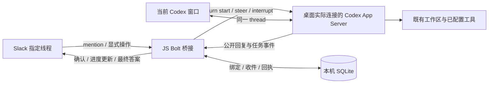

# Slack ↔ 当前 Codex 会话：实施计划

> 执行者：按 superpowers:executing-plans 逐阶段实施；本次只交付计划。默认主 agent 串行实现依赖链，独立检查可以并行；不要求为每个小步骤创建子智能体。

**Goal:** 在指定 Slack 频道 @ 机器人，消息进入当前绑定的 Codex 会话，Slack 与桌面可查看连续上下文、公开进度和最终结果。

**Architecture:** JavaScript Bolt 接收 Slack 事件，经本机桥接服务连接桌面实际使用的 Codex App Server。持久化 Slack 线程与 Codex thread 的绑定；输入和进度都经过同一服务器，不额外启动生成同一会话的 Codex 进程。

**Tech Stack:** JavaScript/Node.js、@slack/bolt、Codex 当前版本的 JSON-RPC 协议、SQLite 持久化、本机 launchd。SQLite 优先使用所选 Node 稳定运行时可用的内置接口；版本不满足时再采用维护中的驱动，不因现有机器能运行就忽略 API 稳定性。

**Spec:** [当前需求及原文](task.md)。阶段与依赖以本文为准。记忆实现与验收见[会话记忆与一致性方案](deliverables/memory-design.md)。

## 目标体验与首版范围

- 你在目标 Slack 线程 @ 机器人发消息，先收到“已收到”。
- 空闲时开启当前 Codex 会话的新一轮；正在工作时，普通追加要求使用该会话的 steer 接口。
- 需要另做一件事时，使用显式“排队”操作；不让模型猜测哪句话会改变正在执行的任务。
- Slack 展示公开说明、执行阶段、等待确认与最终答案；桌面保留原有完整交互。
- “状态”查询读取实际任务状态，不触发新的模型生成。
- “停止”只中断当前绑定的任务，不关闭桌面 App 或其他会话。
- 第一版在这台 Mac 上运行，保持当前工作区与工具环境。休眠时停止响应，唤醒后重连；后台常驻不等于电脑休眠期间仍在线。
- 第一版服务当前已登录的 workspace。首个绑定只允许本人、一个明确频道和一个明确 Slack 线程；这是验证用范围，不是产品硬上限。后续添加映射不改底层结构。
- 外部同事接入不默认复用此私人会话：需要确认共享背景、可见输出和可执行动作后，配置其共享会话与权限。

## 已知事实、待验证项、方案选择

| 项目 | 状态 | 依据 / 下一步 |
|---|---|---|
| JavaScript | 用户已选 | 对话原文“好。JS” |
| Slack 插件与 CLI | 已装 | 插件 1.8.0，CLI 4.14.0，此前命令回读 |
| Slack 登录 | 已完成 | columbiaunive-zxm5569，team T0B2PK88RJ5；本人 U0B2EAU2WN8 |
| 本机 Codex | 已确认运行 | CLI / managed App Server 均为 0.169.0 |
| 当前 App Server 接入 | 未通过 | 只读 proxy initialize 探针未在期限内返回；不是“产品不支持”的证据 |
| 此窗口与 daemon 是否为同一会话服务 | 未确认 | P0 读取 thread 元信息并做双端验证 |
| 旧探针本身是否可靠 | 未确认 | 排查 stdio 缓冲、握手、stderr、socket 所属进程；不能拿脚本超时直接判服务失败 |
| 普通 OpenAI Starter Agent | 不作为推理后端 | 独立 API 会话、内存历史，不能直接满足当前窗口续接 |

选择 **Bolt + 既有 App Server 的薄桥接**。相比每次 `codex exec resume`，它更适合多客户端状态与事件流；相比 Agents SDK 新机器人，它直接围绕现有会话。两种替代方案不作为无声降级。

## 架构

关键条件是 **同一服务、同一 thread**，不是“读到了相同文件”或“复制了一份聊天”。需要确认 app-server 中持久化的工具与指令来源；桌面专属插件、浏览器连接和 UI 工具不因存在 thread ID 就必然可供另一客户端使用。

## Global Constraints

- 所有探针先只读；握手与会话归属确认后，才在测试会话验证写入。当前生产会话的输入验证安排在空闲时，避免给正在生成的计划插入消息。
- 不重启、不升级当前运行的 Codex 服务来碰运气；不直接修改会话数据库、rollout 文件或私有 IPC 协议。
- 使用当前安装版本生成 schema，核对参数与事件名；在线文档可能领先于 0.169.0。
- 不设置 `--last` 猜会话；绑定必须使用核验过的 thread ID，且以 workspace/channel/thread 隔离。
- 沿用现有登录、模型、工作目录和权限策略，不为 Slack 开全盘权限或自动批准权限请求。
- Slack 消息永远是带来源的用户输入，不拼入 system/developer 指令，不作为 shell 命令执行。
- 长期 token 只进受限本机凭据文件；不进入仓库、聊天、日志或 URL。
- 原文、结果和结构化状态不得因“便于显示”丢弃。长答案分段或上传完整文件；若权限不足，要明确保留位置和交付缺口。
- 首版不回放历史消息到 Slack，绑定后只转发被授权会话的新输出；说明“实时可见进度”不包含内部推理或敏感原始工具输出。

## 每阶段交付与验收

以下时间数值均为**建议验收目标，尚未实测**。在正常在线、未被 Slack 限流的条件下测量；限流/断网单列，不从统计中静默删除。

| 阶段 | 范围 / 交付 | 指标与决策门槛 | 实现 |
|---|---|---|---|
| P0 同会话可行性 | 当前 server、thread、工具可用性、双端事件 | 桥接能读准确 thread；测试消息在桌面可见；桌面输入的公开进度可被桥接接收；不生成并行副本 | 版本 schema、可靠 stdio/socket 探针、受控测试 |
| P1 Slack 最小回路 | 指定频道 @ → 收到确认 → 固定测试回执 | 同一事件重投不重复执行；未授权消息不能进入 Codex；测试批次 20 条确认延迟 p95 ≤ 2 秒 | Bolt Socket Mode、app manifest、显式允许列表 |
| P2 输入与持久上下文 | 绑定、start、steer、排队、状态、停止 | 重启后绑定仍在；同线程保留上下文；忙闲竞争不丢消息或重复发起 | 单 thread 调度器、SQLite inbox 和映射 |
| P3 实时输出 | 公开说明、进度、完成、错误、等待确认 | app-server 事件到 Slack 可见更新 p95 ≤ 3 秒；最终输出完整，末次刷新必达或标明失败 | 事件投影、合并更新、限流重试与 outbox |
| P4 常驻与恢复 | launchd、重连、异常恢复、双端联调 | 杀桥接进程后能恢复；重启不重跑已完成任务；断线期间状态能对账 | 服务定义、持久化状态、恢复协议、操作文档 |

P0 是可行性门槛。失败就输出具体缺口并暂停依赖它的开发。若当前桌面不支持共享端点，备选是迁移到可由桌面与桥接共同连接的受支持会话服务；这会改变当前体验，须单独确认。不能用“新开一个相似会话”冒充已完成。

## 文件布局与职责（计划创建，当前未创建）

应用放当前父目录下的 `slack-codex-bridge/` 独立代码仓；harness 项目只留 T04 的任务、证据和结果。创建应用仓时按 repo 工作区管理，不把长期运行程序塞进 config/skills/。

| 文件 | 职责 |
|---|---|
| package.json、package-lock.json | 依赖、Node 版本、start/test/check 脚本 |
| manifest.json | 最小 Slack app 权限、事件与 Socket Mode |
| src/main.js | 生命周期：配置、存储、Codex 连接、Slack 监听 |
| src/config.js | 读取允许列表、服务器端点、绑定配置与凭据位置 |
| src/slack.js | 规范化入站消息、发送确认、更新公开进度 |
| src/codex.js | JSON-RPC、能力核验、thread/turn 方法与事件流 |
| src/store.js | SQLite schema、绑定、收件去重、发送回执 |
| src/bridge.js | 按 thread 排序、状态机、输入与输出关联 |
| tests/*.test.js | 传输、调度、恢复、输出投影测试 |
| scripts/probe-codex.js | 只读握手与指定 thread 元信息探针 |
| launchd/com.yunchen.slack-codex-bridge.plist | 固定绝对路径、启动目录、异常重启和日志位置 |
| README.md、.env.example、.gitignore | 安装/绑定/运行/停止/排错，密钥和状态数据库排除规则 |

### 共用接口

- `connectCodex({ endpoint, clientName, onEvent }) -> Promise<CodexClient>`：`readThread(threadId)`、`resumeThread(threadId)`、`startTurn(threadId, text)`、`steerTurn(threadId, expectedTurnId, text)`、`interruptTurn(threadId, turnId)`、`close()`。生产代码仅使用 P0 已验证的方法与传输。
- `acceptSlackEvent(event) -> Promise<{ accepted, duplicate, receiptId }>`：先验证来源和允许列表，再持久写入 inbox；成功持久化后才确认接收。Bolt 的传输 ACK 与用户可见“已收到”分开处理。
- `handleInput({ eventId, teamId, channelId, slackThreadTs, userId, text, mode })`：`mode` 只取 `message | queue | status | stop`，操作的解析规则写在 README；输入按来源的权限与保留期限保存，编辑、删除与撤权同步到摘要。
- `publishProgress({ receiptId, state, text, terminal })`：只接受已过滤的公开状态与文本；绑定决定 channel/thread，模型文本不能改变发送目的地。

SQLite 最小表：`bindings`（Slack key → server/thread）、`inbox`（event_id 唯一、原文、状态）、`turns`（thread/turn 与发起 Slack 来源）、`outbox`（Slack 消息回执、待发内容、重试状态）。数据库保存在应用的本地 state/ 并排除 Git；日志不记录 token 或完整敏感工具输出。

## Review Focus

1. Slack 重投和程序在“服务已接收、回执尚未落盘”之间崩溃：不能以超时为由直接重跑模型任务。
2. 桌面与 Slack 同时输入，或 steer 目标已完成：不能把追加要求送到错误的 turn。
3. 当前会话含私人历史，或者频道成员新增：允许调用不代表自动允许读取所有历史。
4. 输出限流、断连、长答案与附件：不能只保存截断的最后一段，或提前显示成功。
5. 工具等待批准、桌面专属工具缺失或上下文压缩：不能假装还在顺利执行，或声称恢复了不可用的能力。

## P0：验证当前窗口的共享会话能力

**Files:** `scripts/probe-codex.js`、`tests/codex-transport.test.js`；T04/input 下存版本与脱敏协议证据。

- [ ] 记录桌面、CLI、daemon 版本与端点所属进程。为当前 0.169.0 生成 JSON schema，保存相应命令和版本，不全量导出私人会话。
- [ ] 测试 `split_json_lines`、`multiple_messages_one_chunk`、`out_of_order_rpc_replies`、`stderr_is_not_protocol`，确保旧探针的缓冲问题不会制造假失败。运行 `node --test tests/codex-transport.test.js`，先看到测试明确失败，再实现最小解析器。
- [ ] 实现 `probe({ endpoint, threadId })`：握手只发一次，读取指定 thread 元信息；只输出 id 匹配、状态、工作目录和指令来源路径，不输出历史正文。
- [ ] 验证 read 与 resume 的语义差别：read 成功不代表已经订阅实时事件。按当前 schema 确认恢复后如何接收由另一客户端发起的 turn；不虚构 `thread/subscribe` 方法。
- [ ] 建专用测试会话，验证桥接输入在桌面显示、桌面输入可被桥接观察、公开事件完整。测试通过后，在当前会话空闲且用户知情时验证实际目标，避免把测试当作业务指令。
- [ ] 核查工具来源：本机文件/命令可用，桌面专属插件和浏览器是否仍绑定；缺失能力逐项报告。
- [ ] 产出 P0 结果：通过才进入 P1/P2；不通过记录缺口、可行替代和影响，不改成普通 API bot。

## P1：Slack 接收与快速回执

**Files:** `manifest.json`、`src/config.js`、`src/slack.js`、`src/store.js`、`tests/slack-ingress.test.js`。

- [ ] 写 `mention_from_allowed_user_is_accepted`、`other_channel_is_rejected`、`bot_echo_updates_delivery_without_triggering_turn`、`duplicate_event_is_single_receipt`；`node --test tests/slack-ingress.test.js` 先失败。
- [ ] 创建普通 Bolt JS 接入骨架，不加载独立 LLM provider。最小权限为 `app_mentions:read`、`chat:write`；Socket Mode app-level token 只给 `connections:write`。订阅已获准频道的普通消息以保存讨论上下文，默认由显式 @ 触发答复。按频道类型配置 message.channels / channels:history 或 message.groups / groups:history，按附件需求配置 files:read，上传图解时配置 files:write。
- [ ] 与用户确定频道和首个 Slack 线程；允许用户默认为已登录本人。邀请 app 进入频道后验证 membership，不把登录 CLI 当作 app 已入群。
- [ ] 入站事件先做持久去重，再立即发送“已收到”；模拟 app-server 不可用，状态应明确为“暂未接通”，不能声称任务已开始。
- [ ] 权限和 token 按官方 CLI 隐藏输入/认证流程配置，不打印凭据；manifest validate 通过后才启动。
- [ ] 测试批次按阶段表采样，记录每条入站与可见回执时间，保留失败和重试样本。回归通过后形成局部提交。

### 频道讨论与附件（新增范围）
- [ ] 按频道和线程关联普通消息、编辑、删除和附件引用。读取历史时检查权限及可取时间范围。讨论作为资料，仅授权发送者的明确请求触发执行。
- [ ] 收到 @ 后先发回执，再下载该请求相关附件。Slack 可访问的语音片段走转写，保留时间位置；图片传视觉输入；PDF、Office 与文本按格式提取，保留页码、工作表或段落来源。不支持的格式、缺少权限或转写不清时明确说明。
- [ ] 在测试频道先贴截图、语音、文档并讨论，再 @ 助手追问。验收要求准确引用讨论与附件证据；新开无关线程时不混用上下文。
- [ ] 默认在原线程用要点回复；需要解释结构或依赖时渲染图解并上传可在 Slack 内打开的图片。验收包括内容正确、普通成员可查看，以及处理附件期间仍能收到回执与公开进度。

## P2：上下文连续、忙闲调度与重启恢复

**Files:** `src/codex.js`、`src/bridge.js`、`src/store.js`、`tests/bridge-state.test.js`。

- [ ] 定义状态：`received → queued/submitting → running → waiting/completed/failed/interrupted`；`delivery_unknown` 专门处理服务端是否接收未知的窗口。
- [ ] 写测试：`idle_starts_bound_thread`、`busy_message_steers_expected_turn`、`queue_waits_for_completion`、`status_never_starts_turn`、`stop_only_bound_turn`、`restart_preserves_binding`、`steer_race_reconciles_before_retry`。
- [ ] 一个 Codex thread 同时只有一个本地调度锁，但桌面仍可并发输入；任何 stale-turn 错误必须重新读实际状态，再决定重试，不靠锁假设桌面静止。
- [ ] 发往 Codex 的文本带真实 Slack 来源，内容保持 user 层级。队列消息按持久化顺序处理；目标 thread 被删除或不可访问时停止派发，不偷偷新建会话。
- [ ] 故障测试 `crash_after_server_accept_before_db_commit`：回连后先核查 turn 和已有输入。能确认已受理则继续观察；无法确认则标记“状态待核对”，不自动重复执行。明确不承诺跨 Slack/SQLite/Codex 的分布式 exactly-once。
- [ ] 重启测试使用同一 SQLite 文件与 server/thread 标识，确保上下文持续来自同一会话。上下文可能被 Codex 压缩，不能承诺无限逐字记忆。
- [ ] 运行 `node --test tests/bridge-state.test.js`，通过后提交。

- [ ] 实现分层摘要、已发言对账、决定和未兑现承诺，执行[记忆专项验收](deliverables/memory-design.md)。

## P3：公开实时进度与最终交付

**Files:** `src/slack.js`、`src/bridge.js`、`tests/progress.test.js`。

- [ ] 正向允许列表只投影公开 assistant 消息、工具类型级状态、等待确认和 turn 终态。`reasoning` 类事件、原始命令参数、MCP payload 不发送。
- [ ] 写 `progress_preserves_order`、`reasoning_and_raw_payload_are_not_published`、`terminal_flushes_pending_text`、`rate_limit_obeys_retry_after`、`long_answer_preserves_all_text`、`unrelated_thread_event_is_ignored`。
- [ ] 每个 turn 用一条 Slack 状态消息更新进度；公开说明与终态按需要单独发送。默认合并间隔 1 秒（为减少 API 调用的可调参数），遇 Retry-After 按服务端要求退避。
- [ ] 最终答案超出 Slack 单条容量时分段，分段保留顺序与全部文本；附件按明确权限上传，未获上传权限则在正文标明附件尚未交付。不得把本机文件路径当作群成员都能打开的链接。
- [ ] 权限请求或用户问题第一版只通知“等待你在 Codex 窗口处理”；保留原权限机制，不自动批准。P0 必须确认请求能由桌面接收/解决，否则此能力列为上线阻断。
- [ ] 定义归属：只有已绑定 thread 的新输出可进目标 Slack 线程；桌面发起的任务也仅在该绑定的可见范围内转发。不能转发其他任务或历史回放。
- [ ] 运行进度测试与正常在线的延迟测量，通过后提交。

## P4：常驻运行、联调与交付

**Files:** `src/main.js`、launchd 服务文件、README.md、`tests/recovery.test.js`。

- [ ] 写 `restart_recovers_inbox`、`disconnect_reconciles_terminal_state`、`two_bridge_instances_do_not_double_dispatch`；应用实例使用本机独占锁，持久记录用事务。
- [ ] 启动桥接不启动第二个相同 Codex 会话执行器。端点不可达则重连并展示离线状态；不能用启动新 daemon 或数据库复制掩盖断连。
- [ ] 使用固定 node 路径、工作目录与受限日志文件配置 launchd。安装前展示具体服务定义；不修改用户系统休眠设置。
- [ ] 端到端场景：@ 提问 → 确认 → 公开进度 → 完成；追加要求；排队；状态；停止；等待桌面批准；断线恢复；长答案；未授权用户；Slack 重投。
- [ ] 报告所有测试结果及测量，区分延迟目标与实测。记录应用 ID、频道/线程绑定、服务位置、停止/移除指令。
- [ ] 仅在端到端通过后声明“Slack 可驱动当前窗口的同一会话”。应用开发提交留在独立仓，T04 记录交付链接与验证。

## 回滚与需要用户提供的配置

- 回滚：停用桥接服务即可恢复到只有桌面入口；不删除 Codex 会话、工作区或记忆。移除 Slack app 和本地凭据另行按用户意图执行。
- 上线前需确定目标频道、首个绑定线程和允许访问的人员。本人测试可先采用私有测试频道。
- 如果要给同事访问，先决定是否单独创建共享会话；“同一私人会话”与“多人都能读写”不能默认为同一授权。
- 若必须让 Mac 休眠后仍工作，需要常开主机；该主机必须同时具备对应项目、会话服务与工具环境，单独把 Slack 程序搬上云不能控制睡眠中的 Mac。

## 计划自检

- [x] 原需求覆盖：@ 自动回应、同一上下文、公开实时进度、当前窗口连续性均有实现阶段与验收。
- [x] 把未通过的共享会话连接列为首要门槛，没有把 CLI 安装当成功。
- [x] 覆盖重复事件、并发输入、未知投递、断连、长内容和权限请求。
- [x] 第一版不引入独立模型供应商、不建通用 agent 平台、不把复制历史当作同会话。
- [x] 仅本计划已完成；P0–P4 实施复选框均未勾选。

## 依据

- [Codex App Server](https://learn.chatgpt.com/docs/app-server)：会话、turn、通知与批准协议；实现以本机生成 schema 为准。
- [Slack 官方接入](https://docs.slack.dev/agent-setup/prompt.md)、[Socket Mode](https://docs.slack.dev/apis/events-api/using-socket-mode/)、[app_mention](https://docs.slack.dev/reference/events/app_mention/)。
- [已有进度](progress.md)：安装、登录、语言选择与只读探针结果。
