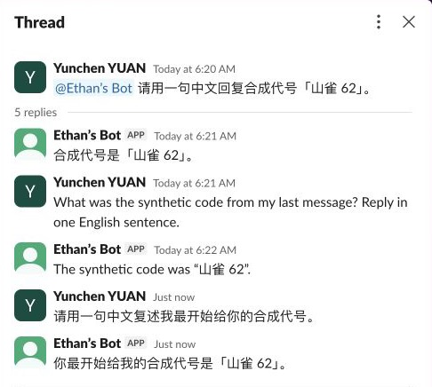

# 精简提示 Slack 无提及追问

在已授权 #test 的[原山雀 62 验收帖](https://columbiaunive-zxm5569.slack.com/archives/C0CJN63KC66/p1795000849936769)，以 Yunchen YUAN 仅发送一次短问。发送前确认 launchd 运行，服务日志最近一次 Socket Mode online 后记录了 Codex connected。未操作绑定。

- [15:56:13.755 UTC 点击的中文请求](https://columbiaunive-zxm5569.slack.com/archives/C0CJN63KC66/p1795017373912349?thread_ts=1795000849.936769&cid=C0CJN63KC66)「请用一句中文复述我最开始给你的合成代号。」没有 @，也没有在问题里写出代号。
- [15:56:27.010 UTC 浏览器看见的答复](https://columbiaunive-zxm5569.slack.com/archives/C0CJN63KC66/p1795017386810229?thread_ts=1795000849.936769&cid=C0CJN63KC66)「你最开始给我的合成代号是『山雀 62』。」正文完整，追加一条 Bot 消息。
- 从点击到完整 Bot 正文可见为 13.255 秒。Slack 请求 TS 1795017373.912349 与回复 TS 1795017386.810229 相差 12.898 秒。该未压缩源样本正确延续了线程上下文，仍超过 10 秒门槛。分段归因使用服务端同请求 TS 的记录。

