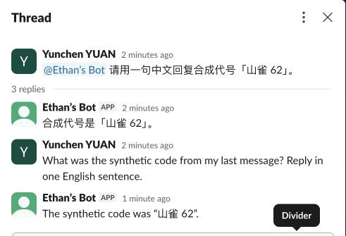

# 忙时首答候选 Slack Web 冒烟

**功能通过，10 秒体验门槛未通过。** 2026-11-18 部署通知后，以 Yunchen YUAN 在已授权私有 #test 开了[一个根帖](https://columbiaunive-zxm5569.slack.com/archives/C0CJN63KC66/p1795000849936769)。Chrome 已登录且使用浏览器 DOM 接口操作。正式 @ 只在根帖出现，英文追问未 @。线程未换绑定。

| 问答 | UTC 点击发送 | UTC 浏览器首次观测可见 | 点击到首见 | Slack 请求到答复 |
|---|---|---|---:|---:|
| 中文首问 | 11:20:49.768 | 11:21:21.897 | 32.129 秒 | 31.798 秒 |
| 英文追问 | 11:21:37.328 | 11:22:13.102 | ≤35.774 秒 | 24.181 秒 |

浏览器时间以点击调用前的本机时刻为起点，以匹配到完整 Bot 正文为终点。英文两次浏览器观察之间存在间隔，答复在后一轮打开观察时已经可见，表中记为上界。最后一列使用各自请求和答复的 Slack 消息时间戳，同一时钟的差值。中文的初次 9.271 秒观察窗未见回答，续等时看到正文出现。每种请求仅试一次。

| 可见观察 | 原文或永久链接 |
|---|---|
| 中文用户请求 | [1795000849.936769](https://columbiaunive-zxm5569.slack.com/archives/C0CJN63KC66/p1795000849936769)「请用一句中文回复合成代号『山雀 62』。」 |
| 中文 Bot 正文 | [1795000881.735129](https://columbiaunive-zxm5569.slack.com/archives/C0CJN63KC66/p1795000881735129?thread_ts=1795000849.936769&cid=C0CJN63KC66)「合成代号是『山雀 62』。」 |
| 无 @ 英文用户请求 | [1795000897.443359](https://columbiaunive-zxm5569.slack.com/archives/C0CJN63KC66/p1795000897443359?thread_ts=1795000849.936769&cid=C0CJN63KC66) “What was the synthetic code from my last message? Reply in one English sentence.” |
| 英文 Bot 正文 | [1795000921.624439](https://columbiaunive-zxm5569.slack.com/archives/C0CJN63KC66/p1795000921624439?thread_ts=1795000849.936769&cid=C0CJN63KC66) “The synthetic code was ‘山雀 62’.” |

同一线程最终有两条 Bot 消息，每次各一条完整正文。可见答复没有内部标记、占位进展或额外文本。浏览器证据只覆盖用户可见交付与时延，具体候选快路由和后端事件按主会话记录核实。

