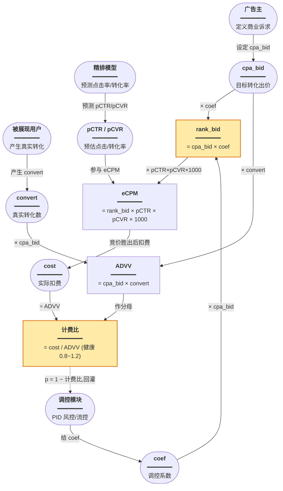

# dag-flow-diagram · 范例库（范例三/四/五为对应场景必读）

> 自 SKILL.md 迁出（2026-07-01，逐字未改写；templates/ 相对路径已随迁修正为 ../templates/）。规则（节点/边/闭环/布局闸/渲染配方）见 SKILL.md。

## 范例一:变量依赖图(广告计费核心概念 DAG)

要点:外部参与者按身份配色;每条边带公式;无凭空变量;计费比虚线回灌 coef 闭环。(这是**多入边汇聚的依赖网**、不是线性条,TB 渲染后是矩形不会成竖条,可保留 TB;只有**纯线性顺序流**才必须改 LR。嵌图前仍按「布局与长宽比」过长宽比闸。)

## 范例二:端到端服务拓扑(概述图,藏底层细节)

要点:不同阶段独立 entity;edge 带传递数据;焦点节点高亮;只到服务粒度,内部细节留给模块图。**这是线性顺序流,用 `flowchart LR`(左右)——若用 TB 会排成瘦高竖条**(见「布局与长宽比」)。

## 范例三:开篇全景总控图(hero SVG 模版 · 开篇全景首选 · 每次必读)

落地模版 = [`templates/panorama_overview.svg`](../templates/panorama_overview.svg)(1600×900 手写 SVG → headless Chrome 2× 截 PNG → 嵌 Image 块,render 走上「渲染配方」)。这是**比「开篇导览 DAG」更进阶的开篇全景**:当一套体系不只是线性阶段链,而是「主链 + 多条并行路线 + 远期侧栏」的多板块鸟瞰时,套这张的结构。**换内容不换骨架**:

1. **标题区 + 图例**:左上大标题 + 一句副标题点出全景在讲什么;右上图例先交代分区配色 / 高亮语义(如程序 A/B、当前位置、远期缺口),读者未读正文先懂配色含义。
2. **横向主链带(顶部)**:主干阶段一行横排(每节点一个阶段、不展开内部)——等价「开篇导览 DAG」的阶段链,但用 SVG 卡片排得更稳,不踩 mermaid 瘦高竖条。
3. **平行路线对照(中部)**:每条路线一行,**左侧竖排标签 tab** 锚定身份;行内「来源框 → 箭头 → 状态框 → 对齐虚线 → 演进框」串起该路线链路与状态,数值 / owner 直接标进框里。
4. **远期 / 缺口侧栏(右侧)**:虚线描边 + slate 灰框,装「体系之外 / 远期 / 团队缺口」的内容,与主体实色块明确区分。
5. **hero 分区配色(全图统一)**:同区同色、颜色一致表同类身份(对齐上「hero 风格规范」);**当前位置用高亮虚线框单独标出**。
6. **实证 footer**:底部一行小字标数据口径 / 来源(数值来自哪篇文档、哪些结论尚未落地),让全景可溯源、不虚标。

**长宽比**:1600×900 = w/h≈1.78,正落理想带;开篇全景这种横向宽图按 2× 渲染、长宽比放宽到 ≤3(见「渲染配方」例外)。⛔ 不把开篇全景塞成纯文字段落或瘦高竖条;⛔ 不在全景里堆公式(公式是正文 ASCII 的活)。

## 范例四:全文结尾总收口 DAG(hero · 收口必读)

落地模版 = [`templates/closing_summary_b1.png`](../templates/closing_summary_b1.png)(2200×1160,w/h≈1.9;手写 SVG/dot → headless Chrome 2× 截 PNG)。这是「**结尾总收口 DAG**」范式(上「学习文档的两个 DAG 范式」的结尾端)的落地范例——与范例三分工:**开篇全景给「鸟瞰定位」**(分几段、我在哪),**结尾总收口给「收束细化」**:把全文散在各节的核心概念收成一张**比正文更全**的关系总图,纳入开篇图没展开的量化 / 机制 / 旁支。

**结构拆解(B1「数据与样本」为例,换内容不换骨架)**:
1. **标题点全文逻辑主轴**:`X 全文逻辑总图 · 阶段A → 阶段B → 阶段C → 产出` + 副标题列本图纳入的硬细节(此处:打标三环节 / 250 万 / 三表征 / pacs),一眼知道这是收口图、比开篇全。
2. **多行左右流、按大阶段分带**:顶行 = 数据生产链(多源信息 → 评估大模型三环节打标 → pipeline 提纯 → 250 万);中行 = 训练链(Stage1/2/3 + 版本演进面板 → product_emb);底行 = 下游样本三类分叉(召回 pair / 行为序列 / 精排交叉 + pacs 合规框)。每带一个大阶段,横向推进。
3. **纳入开篇图省略的硬细节**(= 「比正文更全」的体现):具体数量(250 万)、版本演进(emb 2.0→4.1、30d→180d、+68.66%)、合规机制(pacs uid 不出域 / 只传 pid_list / hash 配回)、下游样本规格(user emb 128d、product emb [10,128])。
4. **关键节点高亮 + 跨阶段虚线**:核心产出(250 万训练数据、版本演进面板)用高亮块;复用 / 回路关系(如「插入 Stage2 对比微调」)用虚线跨阶段指回,显式画依赖而非断层。
5. **下游出口接回全体系**:最右画出召回链路(B3)、精排特征(B4)的出口,把本篇收口同时接到下游兄弟篇。
6. **实证 footer**:底部注释标口径(product_emb 定义、pacs、三表征本质同源),让收口图可溯源。

**长宽比** 2200×1160 = w/h≈1.9,落理想带。⛔ 结尾收口**不是开篇图的复制**——必须比开篇更全(纳入量化 / 机制 / 旁支);也别堆未在正文出现的新概念(收口 = 收束已讲的,不引入新的)。

## 范例五:板块定位图(每篇开头 · 定位必读)

落地模版 = [`templates/locator_b2.png`](../templates/locator_b2.png)(1960×940,w/h≈2.09)。这是「**板块定位图**」——上「学习文档的两个 DAG 范式 · 开篇导览 DAG」的落地范例:每个板块篇(B1-B6)开头第一张图,把**全链路 N 个阶段一字横排**、**高亮本篇覆盖的阶段(其余灰显)**,让读者一眼知道「这套系统分几段、我在读哪段、本篇输入→输出是什么」。与范例三分工:**范例三全景**是总览入口(entry)用、画全系统多路细节;**本范例定位图**是每个板块篇用、只画「我在哪段 + 本段 I/O」,更轻。

**结构拆解(B2 为例,换内容不换骨架)**:
1. **标题 + 一句定位副标题**:`全链路 N 阶段 · 导览` + 副标题点明「本篇 = 第几段」(B2:6 阶段里讲透上游 ①②)。
2. **全链阶段一字横排**:整条链路 N 个阶段做成横排卡片(①上游→②分化→③服务化→④召回→⑤精排),阶段间箭头串起。
3. **高亮本篇、灰显其余**:本篇覆盖的阶段高亮 + 「本文」角标,其余灰显——一眼定位自己在读哪段;图例标「本文 / 其他阶段」。
4. **每卡带本段输入→输出**:每阶段卡内一句「什么进、什么出」(本文 ①Qwen3-VL 编码图文→商品向量、②长出 i2i/vision/feature),非空盒。
5. **横切阶段单列底带**:评估 / 上线 / AB 这类横切所有阶段的,单独画一条底带,不挤进主链。
6. **footer 收回本篇焦点**:底部一句把读者从全景拉回本篇要讲的那一两段。

**长宽比** 1960×940 = w/h≈2.09,横向导览带天然偏宽,放宽到 ≤3(见「渲染配方」开篇导览例外)。⛔ 定位图只画「阶段 + 高亮本篇 + 一句 I/O」,不展开公式 / 内部细节(那是正文 ASCII / 详细 DAG 的活)。
