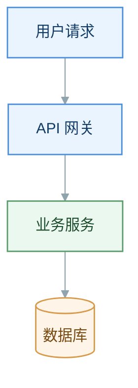
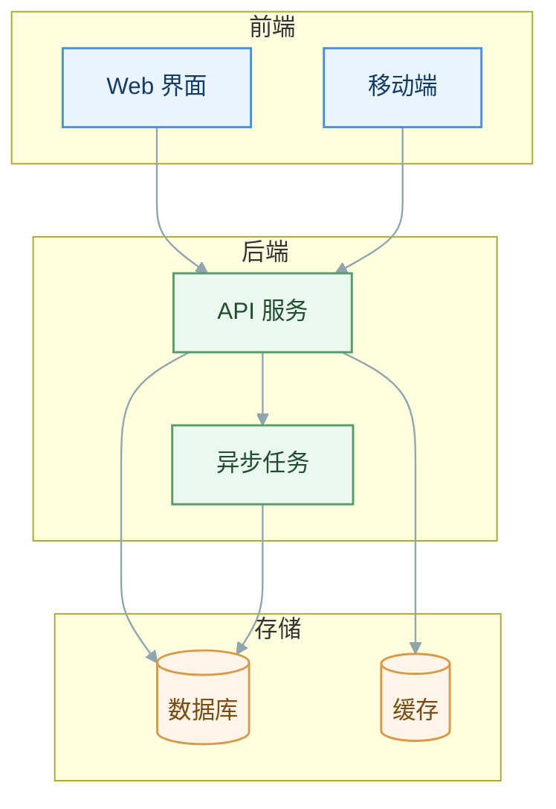

# Mermaid DSL 模板总览

> 本目录是飞书画板 Mermaid 代码块的专业 DSL 模板参考。每个文件包含：语法要点 + 配色方案 + 完整示例。

## 目录

1. [通用规则与配色](#通用规则与配色)（本文件）
2. [流程图 Flowchart / Graph](01-flowchart.md)
3. [时序图 Sequence Diagram](02-sequence.md)
4. [类图 Class Diagram](03-class.md)
5. [ER 图](04-er.md)
6. [状态图 State Diagram](05-state.md)
7. [甘特图 Gantt](06-gantt.md)
8. [饼图 Pie](07-pie.md)
9. [思维导图 Mindmap](08-mindmap.md)
10. [时间线 Timeline](09-timeline.md)

---

## 通用规则

### 节点 ID 命名

- **必须用英文/拼音**，简短有意义：`A` `B` `SVC` `DB` `USR`
- **显示标签可中文**：`A[用户服务]` ✅ / `用户服务[用户服务]` ⛔
- 禁止中文 ID、emoji ID、特殊 Unicode ID

### 标签长度

- **≤50 字符**，过长截断或用缩写
- 超长文本用 ` ` 换行：`A[数据采集 与清洗]`

### 语法字符

- **仅用 ASCII**：⛔ 禁止中文括号 `（）`、emoji、特殊 Unicode（→ ① ② 等）
- 箭头用 Mermaid 语法：`-->` `->>` `-->>` 等，不要用 Unicode 箭头

### 禁用类型

⛔ 以下 Mermaid 类型飞书不支持，使用会报错：
`journey` / `quadrantChart` / `gitGraph` / `C4`（含所有变体）/ `sankey` / `xychart`

---

## 配色方案

⛔ **核心原则：单图最多 3 种颜色，禁止 4+ 色混用导致眼花缭乱；默认优先浅蓝/浅绿，禁止大面积黄底。**

### 配色方案（按场景选择）

| 场景 | 配色组合 | classDef |
|------|----------|----------|
| **架构/系统图** | 入口 + 服务 + 数据 | `blue` + `green` + `orange` |
| **流程/决策图** | 主流程 + 判断 + 异常 | `blue` + `orange` + `red` |
| **数据流/管道** | 源 + 处理 + 目标 | `blue` + `green` + `orange` |
| **简单流程** | 主色 + 强调 | `blue` + `green` |
| **状态机** | 正常 + 警告 + 终止 | `green` + `orange` + `red` |
| **对比/两方** | A 方 + B 方 | `blue` + `green` |

### classDef 配色法（推荐）

⛔ 只定义本图用到的 2-3 个 classDef，不要全部定义：

### 全色板（备用，⛔ 不要在单图中全部使用）

| 用途 | 背景色 | 边框色 | 文字色 | classDef 名 | 使用条件 |
|------|--------|--------|--------|-------------|----------|
| 用户/入口 | `#EAF4FF` | `#4C8FD9` | `#123B66` | `blue` | 架构图/交互图 |
| 服务/处理 | `#EAF8EF` | `#5B9B6B` | `#1F4D2E` | `green` | 几乎所有图 |
| 数据/存储 | `#FFF4E8` | `#D79A4A` | `#7A4B12` | `orange` | 含数据库/存储 |
| 错误/告警 | `#FDEEEE` | `#D26A6A` | `#7A1F1F` | `red` | 含错误分支 |
| 缓存/中间件 | `#F3ECFA` | `#8B6FB3` | `#4C346E` | `purple` | 含缓存/MQ（⛔ 与 blue 二选一） |
| 外部/第三方 | `#F6F7F9` | `#98A2B3` | `#475467` | `gray` | 含外部系统 |
| 核心/重点 | `#ECF8FB` | `#5FA9B8` | `#14505C` | `cyan` | 仅高亮 1-2 个关键节点，默认不用黄底 |

### 行内样式法（简单场景）

> `classDef` 优于 `style`：可复用、易维护、节点多时不冗余。

---

## 方向选择

| 方向 | 适用场景 | 语法 |
|------|----------|------|
| `TD` / `TB` | 层级架构、组织关系、自上而下流程 | `flowchart TD` |
| `LR` | 水平流程、时间线、数据流、微服务架构 | `flowchart LR` |
| `RL` | 右到左（少用） | `flowchart RL` |
| `BT` | 自下而上（少用） | `flowchart BT` |

**方向决策**：节点 ≤8 且有明确层级 → `TD`；节点 >8 或数据流/管道 → `LR`（避免纵向过长）
**对齐补充**：主链路节点优先放中轴；同层节点尽量同一行；每行主节点尽量不超过 4 个

---

## 布局规则

### subgraph 分组（⛔ ≥3 个同类节点必须用）

**分组原则**：
- 同层/同域节点归入同一 `subgraph`
- subgraph 命名用中文：`前端` `后端` `存储` `中间件` `外部`
- 同级 subgraph 内节点数量尽量均衡
- 单图 ≤20 节点；>20 → 拆分多图
- 主干链路先写，分支后写，减少自动排版时的错位

### 连线规则

| 场景 | 连线语法 | 说明 |
|------|----------|------|
| 正常流转 | `A --> B` | 实线箭头 |
| 条件分支 | `A -->|是| B` / `A -->|否| C` | ⛔ 分支必须标注 |
| 返回/响应 | `A -.-> B` | 虚线箭头 |
| 关键路径 | `A ==> B` | 粗线箭头 |
| 时序请求 | `A ->> B` | 实线（sequenceDiagram） |
| 时序响应 | `A -->> B` | 虚线（sequenceDiagram） |

**减少交叉**：同层节点从左到右排列；跨层连线从上到下；避免回形连线
**线宽建议**：普通线统一 `1.2px`，节点边框统一 `1.5px`，避免“线粗于节点边框”的失衡感

---

## 节点形状速查

| 形状 | 语法 | 用途 |
|------|------|------|
| 矩形 | `A[标签]` | 普通步骤/处理 |
| 圆角矩形 | `A([标签])` | 起止/开始/结束 |
| 菱形 | `A{标签}` | 判断/条件 |
| 圆形 | `A((标签))` | 连接点/汇合 |
| 圆柱 | `A[(标签)]` | 数据库/存储 |
| 双线矩形 | `A[[标签]]` | 子流程 |
| 六边形 | `A{{标签}}` | 准备/预处理 |
| 旗帜 | `A>标签]` | 输入/输出 |

**形状选择原则**：⛔ 禁止全用矩形，按语义选形状——数据库用圆柱 `[(...)]`，判断用菱形 `{...}`，起止用圆角 `([...])`

---

## 画板自检清单

生成画板代码后，逐条检查：

1. **配色 ≤3 种**？→ 禁止 4+ 色混用
2. **flowchart/graph 每个节点都有 `:::颜色`**？→ 无灰色/默认色节点（其他图表类型由飞书自动配色）
3. **同类节点同色**？→ 入口全 blue，服务全 green？
4. **≥3 个同类节点有 `subgraph`**？禁止 10+ 节点平铺？
5. **连线标签**：条件分支有 `-->|是|` / `-->|否|`？
6. **形状区分**：数据库用圆柱，判断用菱形，起止用圆角？
7. **方向合理**：层级 TD，流程 LR？
8. **节点数**：单图 ≤20？
