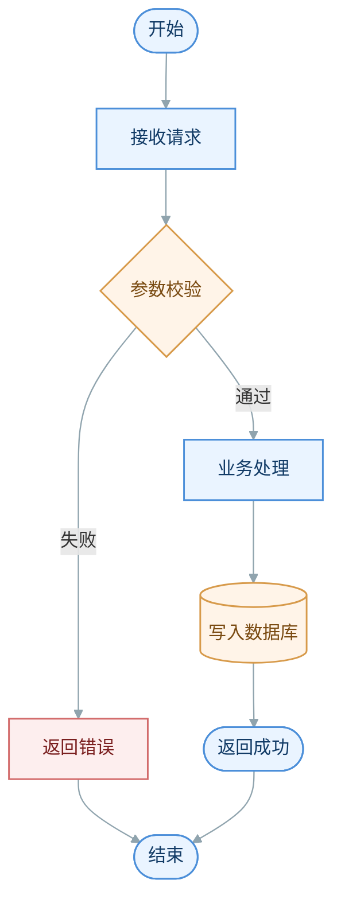
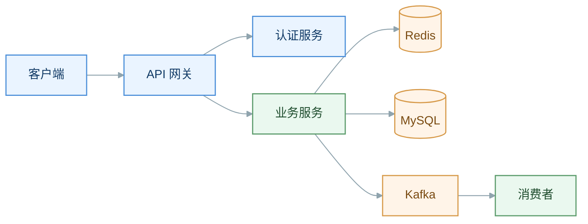
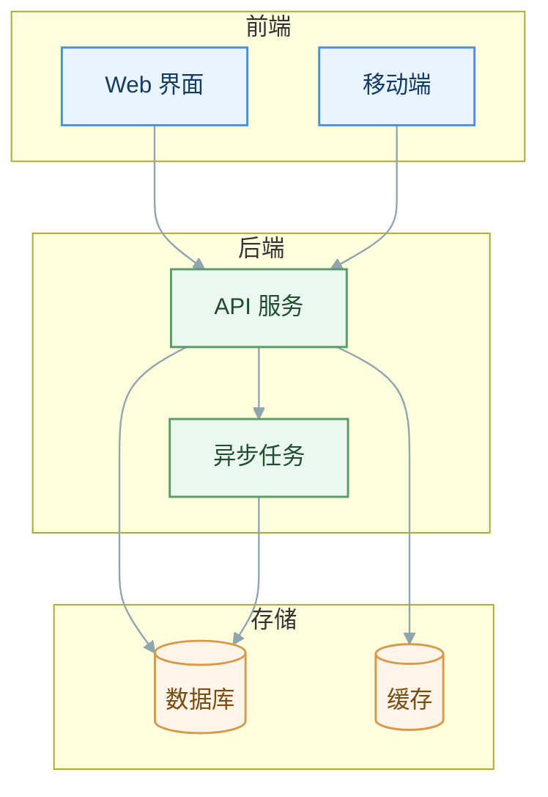

# 流程图 Flowchart

> 飞书画板中最常用的图类型。适用于：业务流程、决策分支、数据处理管道、系统交互。

## 语法要点

```
flowchart <方向>
    节点定义 + 连线
```

- ⛔ **必须用 `flowchart`，禁止用 `graph`**：`graph` 是旧语法，不支持 `linkStyle default`，会导致 `Cannot set properties of undefined (setting 'rank')` 渲染失败
- 方向：`TD`（默认推荐）/ `LR`（水平流程）
- 连线：`-->`（实线箭头）/ `-.->`（虚线箭头）/ `==>`（粗线箭头）
- 标签连线：`A -->|标签| B` 或 `A -- 标签 --> B`
- 子图：`subgraph 标题 ... end`

## 配色模板

⛔ 单图最多 3 色，默认优先浅蓝/浅绿；黄色底色不作为默认方案。架构图：blue+green+orange；决策图：blue+orange+red。

```mermaid
flowchart TD
    classDef blue fill:#EAF4FF,stroke:#4C8FD9,stroke-width:1.5px,color:#123B66
    classDef green fill:#EAF8EF,stroke:#5B9B6B,stroke-width:1.5px,color:#1F4D2E
    classDef orange fill:#FFF4E8,stroke:#D79A4A,stroke-width:1.5px,color:#7A4B12
    linkStyle default stroke:#90A4AE,stroke-width:1.2px
```

## 示例 1：决策流程



## 示例 2：微服务架构（LR）



## 示例 3：子图分组



## 常见错误

| 错误 | 正确 |
|------|------|
| `graph TD`（旧语法，`linkStyle` 会报 `rank` 错误） | `flowchart TD` |
| `用户服务 --> 数据库` | `SVC[用户服务] --> DB[(数据库)]` |
| `A[非常非常非常长的标签文字超过五十个字符]` | `A[长标签<br/>换行显示]` |
| `A（判断）` 中文括号 | `A{判断}` |
| 无配色全灰 | 用 `classDef` + `:::` 配色 |
| 线条太粗发黑 | `linkStyle default stroke:#90A4AE,stroke-width:1.2px` |
| 同层节点错位 | 主链路先写，分支后写；每行主节点尽量不超过 4 个 |
