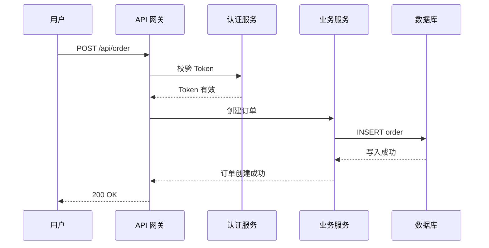
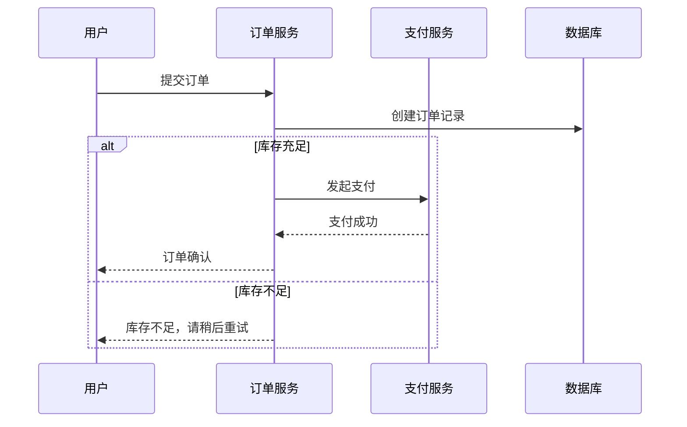
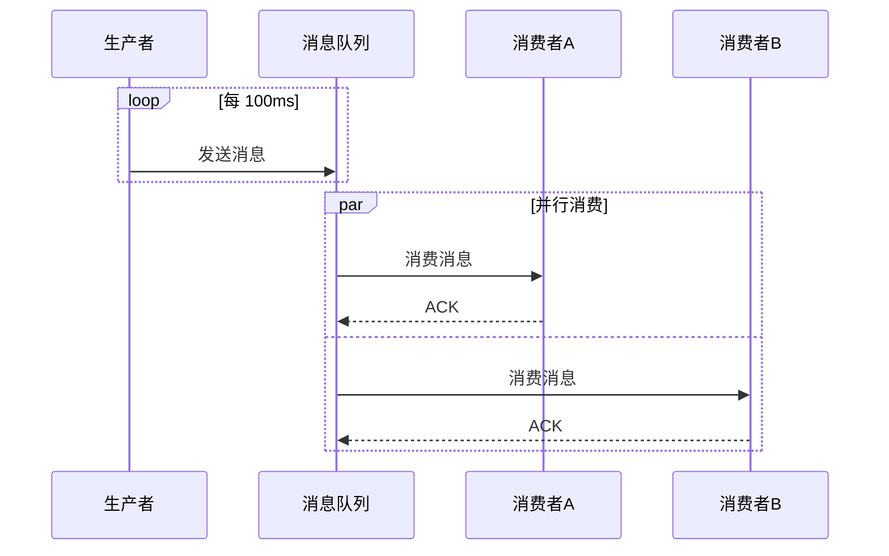
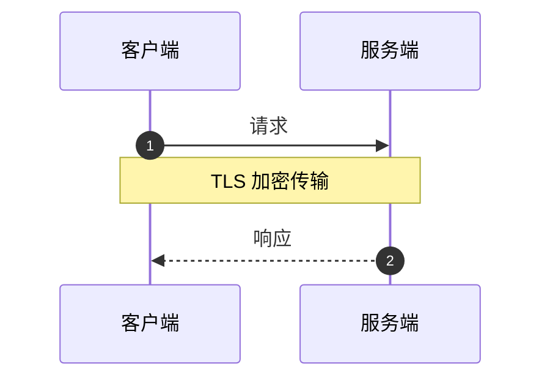

# 时序图 Sequence Diagram

> 适用于：服务交互、API 调用链、用户操作流程、协议交互。

## 语法要点

```
sequenceDiagram
    participant A as 显示名
    A->>B: 同步消息
    B-->>A: 返回消息
    A-)B: 异步消息
```

- `->>` 实线箭头（同步请求）
- `-->>` 虚线箭头（返回/响应）
- `-)` 开放箭头（异步）
- `--x` 失败/拒绝
- `Note over A,B: 说明文字`
- `alt` / `opt` / `loop` / `par` 控制块

## 示例 1：API 调用链



## 示例 2：条件分支



## 示例 3：循环 + 并行



## 配色技巧

时序图不支持 `classDef`，但可通过 `autonumber` 和 `Note` 增强可读性：



## 常见错误

| 错误 | 正确 |
|------|------|
| `A->B:` 缺少 `>` | `A->>B:` |
| 中文冒号 `A->>B：消息` | 英文冒号 `A->>B: 消息` |
| participant 名含空格 | 用 `as` 别名：`participant SVC as 业务服务` |
