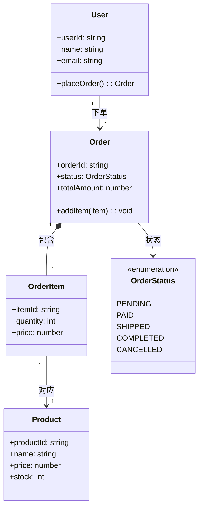

# 类图 Class Diagram

> 适用于：数据模型、领域驱动设计、API 数据结构、系统模块关系。

## 语法要点

```
classDiagram
    class ClassName {
        +publicField: Type
        -privateField: Type
        +methodName(): ReturnType
    }
    ClassA <|-- ClassB : 继承
    ClassA *-- ClassB : 组合
    ClassA o-- ClassB : 聚合
    ClassA --> ClassB : 依赖
    ClassA ..> ClassB : 虚线依赖
    ClassA ..|> InterfaceB : 实现
```

## 关系类型

| 语法 | 含义 | 箭头方向 |
|------|------|----------|
| `<|--` | 继承 | 子 → 父 |
| `*--` | 组合（强拥有） | 整体 → 部分 |
| `o--` | 聚合（弱拥有） | 整体 → 部分 |
| `-->` | 关联 | 源 → 目标 |
| `..>` | 依赖 | 源 → 目标 |
| `..|>` | 实现 | 实现 → 接口 |

## 示例：电商领域模型



## 常见错误

| 错误 | 正确 |
|------|------|
| `class 用户订单` 中文类名 | `class UserOrder` 英文类名 |
| 字段无类型 `+name` | `+name: string` |
| 关系方向反了 | 箭头指向被依赖方 |
