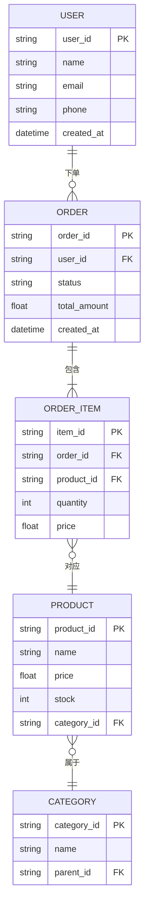

# ER 图 Entity-Relationship

> 适用于：数据库设计、数据模型关系、表结构说明。

## 语法要点

```
erDiagram
    ENTITY ||--o{ ENTITY : "关系描述"
    ENTITY {
        type field_name "说明"
    }
```

## 关系语法

| 语法 | 含义 |
|------|------|
| `\|\|--\|\|` | 一对一 |
| `\|\|--o{` | 一对多（右侧可选） |
| `\|\|--\|{` | 一对多（右侧必须） |
| `o{--o{` | 多对多 |

## 字段类型

常用：`string` `int` `float` `boolean` `datetime` `json` `text`

## 示例：电商数据库



## 常见错误

| 错误 | 正确 |
|------|------|
| 关系描述用中文引号 | 用英文双引号 `"下单"` |
| 字段名含空格 | 用下划线 `user_id` |
| 缺少 PK/FK 标注 | 主键加 `PK`，外键加 `FK` |
