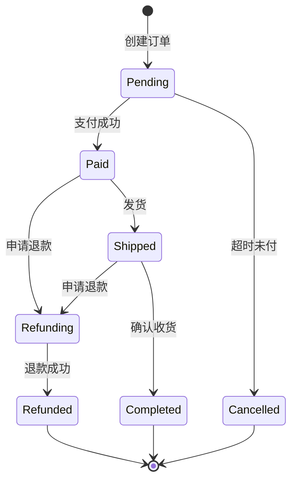
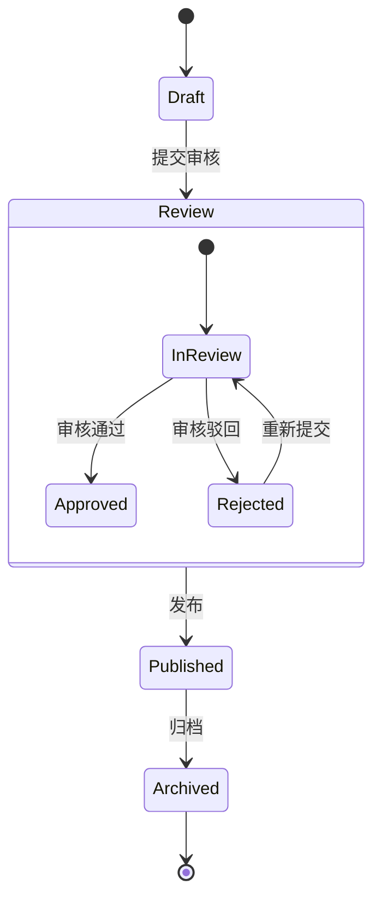

# 状态图 State Diagram

> 适用于：订单状态流转、工单生命周期、审批流程、有限状态机。

## 语法要点

```
stateDiagram-v2
    [*] --> State1
    State1 --> State2 : 事件/条件
    State2 --> [*]
```

- `[*]` 表示开始/结束
- `: 事件` 标注转换条件
- `state "显示名" as ID` 使用别名
- `note left of / right of` 添加注释

## 示例 1：订单状态机



## 示例 2：带子状态



## 常见错误

| 错误 | 正确 |
|------|------|
| `stateDiagram` 旧语法 | `stateDiagram-v2` 新语法 |
| 状态名含空格 | `state "审核中" as InReview` |
| 忘记 `[*]` 起止 | 必须有开始和结束 |
