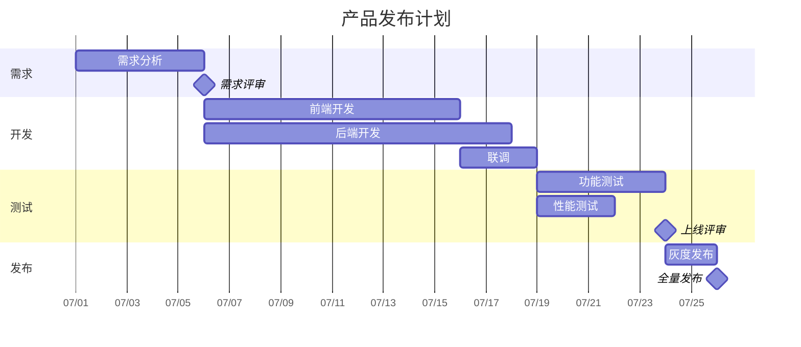

# 甘特图 Gantt

> 适用于：项目排期、里程碑计划、版本规划、任务时间线。

## 语法要点

```
gantt
    title 项目标题
    dateFormat YYYY-MM-DD
    axisFormat %m/%d

    section 阶段名
    任务名 :a1, 2025-01-01, 7d
    任务名 :a2, after a1, 5d
    里程碑 :milestone, a3, 2025-01-20, 0d
```

- `dateFormat` 日期格式
- `axisFormat` 轴显示格式
- `section` 分组
- `after ID` 依赖前置任务
- `0d` 表示里程碑
- 状态：`active` / `done` / `crit`（关键路径）

## 示例：项目排期



## 常见错误

| 错误 | 正确 |
|------|------|
| 日期格式不一致 | 统一用 `YYYY-MM-DD` |
| 里程碑用非零天数 | 里程碑 `0d` |
| 缺少 `dateFormat` | 必须声明 |
