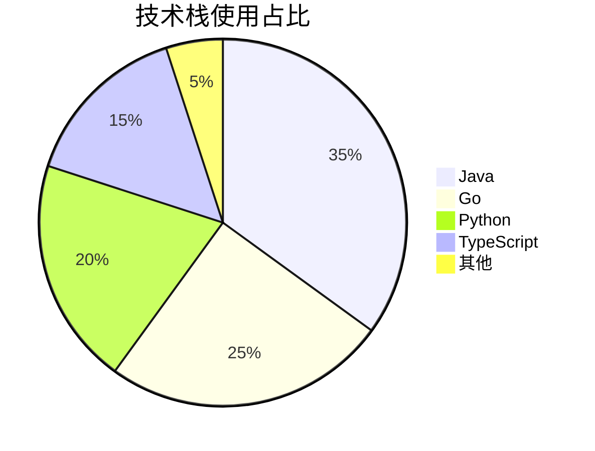
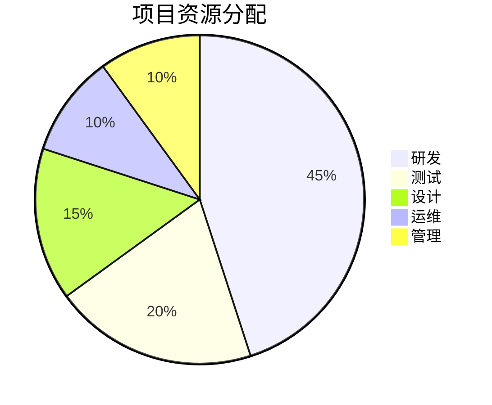

# 饼图 Pie

> 适用于：比例分布、占比分析、资源分配、市场份额。

## 语法要点

```
pie title 标题
    "标签A" : 数值A
    "标签B" : 数值B
```

- `title` 可选标题
- 每行一个扇区：`"标签" : 数值`
- 数值为正数，自动计算占比
- 不支持 `classDef` 配色，飞书自动分配颜色

## 示例 1：技术栈占比



## 示例 2：资源分配



## 常见错误

| 错误 | 正确 |
|------|------|
| 标签不加引号 `Java : 35` | `"Java" : 35` |
| 数值为负或零 | 数值必须为正数 |
| 试图用 classDef 配色 | 饼图不支持自定义配色 |
| 缺少 `title` | 建议始终添加标题 |
