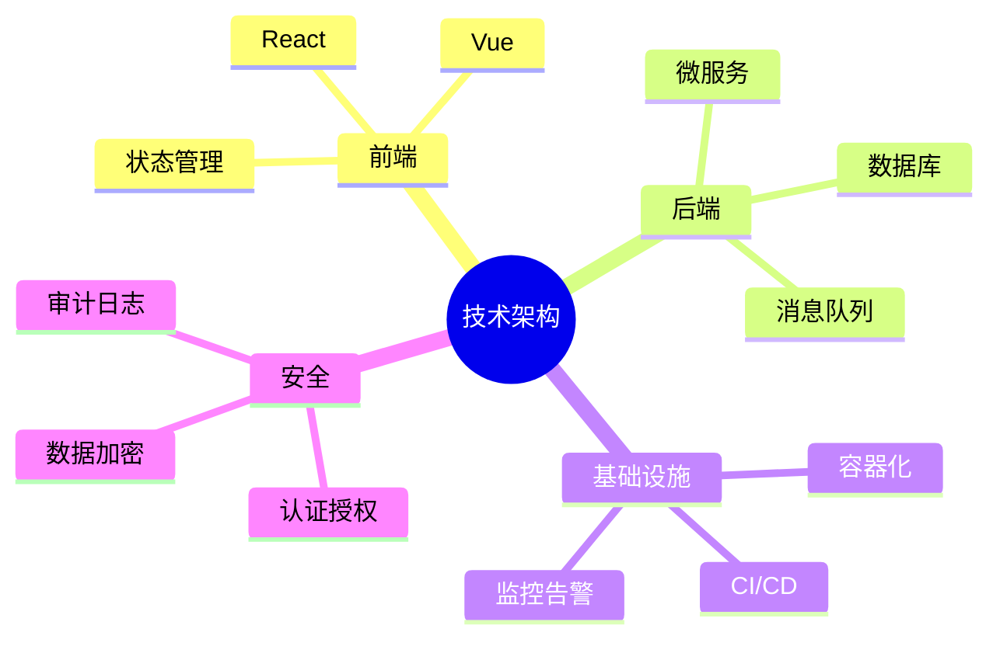
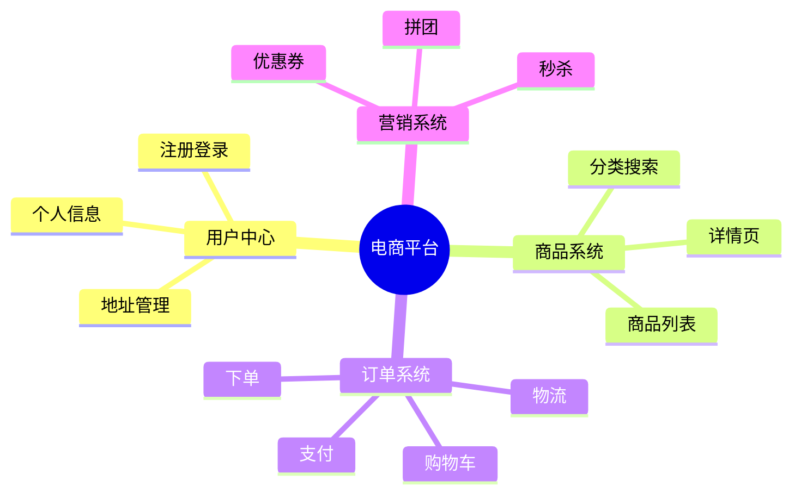
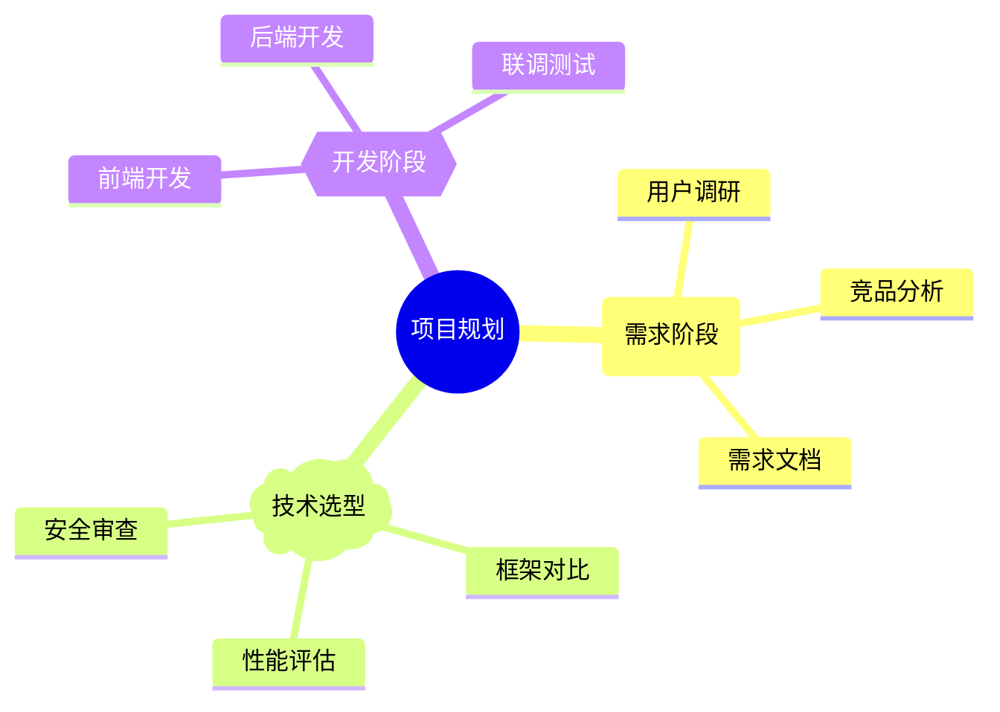

# 思维导图 Mindmap

> 适用于：知识体系、分类结构、头脑风暴、组织架构、模块拆解。

## 语法要点

```
mindmap
  root((中心主题))
    分支1
      子分支1-1
      子分支1-2
    分支2
      子分支2-1
```

- `root((主题))` 圆形根节点（必须双括号）
- **缩进表示层级**（2/4/6 空格，每级递增 2 空格）
- 每层可多个子节点
- 不支持 `classDef` 配色
- 不支持连线标签

## 节点形状

| 形状 | 语法 | 用途 |
|------|------|------|
| 圆形 | `root((主题))` | 根节点 |
| 矩形 | `主题` | 默认子节点 |
| 圆角 | `(主题)` | 强调节点 |
| 菱形 | `)主题(` | 决策/判断 |
| 六边形 | `{{主题}}` | 分类/分组 |

## 示例 1：技术架构



## 示例 2：产品功能拆解



## 示例 3：带形状节点



## 常见错误

| 错误 | 正确 |
|------|------|
| `root[主题]` 方括号 | `root((主题))` 双圆括号 |
| 缩进不一致（混用空格和Tab） | 统一用空格，每级 +2 |
| 子节点前无空格 | 必须有缩进表示层级 |
| 试图用 classDef 配色 | 思维导图不支持自定义配色 |
| 节点文本含特殊字符 | 用纯文本，避免 `{}[]()` |
