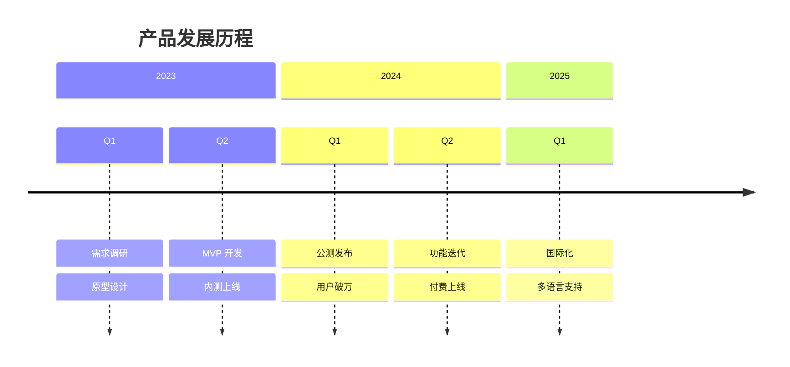
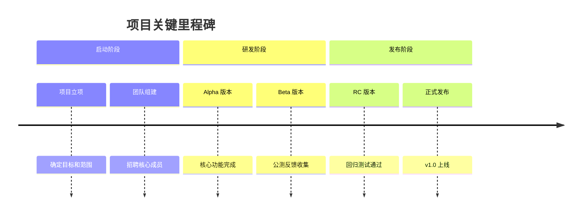
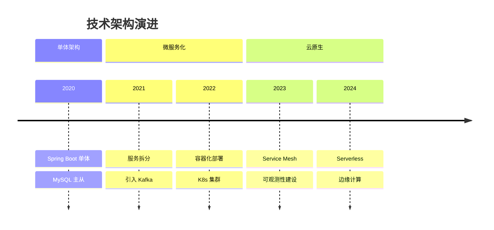

# 时间线 Timeline

> 适用于：项目里程碑、版本历史、发展历程、事件回顾、路线图。

## 语法要点

```
timeline
    title 标题
    section 阶段1
        事件1 : 描述1
        事件2 : 描述2
    section 阶段2
        事件3 : 描述3
```

- `title` 可选标题
- `section` 阶段分组（年份/季度/阶段名）
- 每行事件用 ` : ` 分隔（事件名 : 描述）
- 同一 section 下可多行
- 不支持 `classDef` 配色
- 不支持连线/箭头

## 示例 1：产品发展历程



## 示例 2：项目里程碑



## 示例 3：技术演进



## 常见错误

| 错误 | 正确 |
|------|------|
| 事件描述用中文冒号 `：` | 英文冒号 ` : ` |
| section 后无空行 | section 下直接写事件 |
| 试图用 classDef 配色 | 时间线不支持自定义配色 |
| 多个事件用逗号分隔 | 每个事件独立一行 |
| 缺少 `title` | 建议始终添加标题 |
