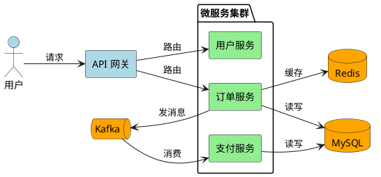

# 飞书画板 PlantUML 语法完全参考手册

> **适用范围**：飞书文档画板（Board）中的 PlantUML 代码绘图功能。
> **核心原则**：画板 PlantUML ≠ 官方 PlantUML。画板会将代码转为可编辑的矢量图形，样式跟随画板主题，部分官方语法存在降级或不支持。
> **使用方式**：在飞书文档中使用 ` ```plantuml ` 代码块，飞书自动渲染为画板图形。

---

## 目录

1. [支持的图表类型总览](#1-支持的图表类型总览)（本文件）
2. [时序图（Sequence Diagram）](01-sequence.md)
3. [流程图 / 活动图（Activity Diagram）](02-activity.md)
4. [类图（Class Diagram）](03-class.md)
5. [ER图 / 对象图（Object Diagram）](04-object-er.md)
6. [状态图（State Diagram）](05-state.md)
7. [用例图 / 组件图（UseCase / Component Diagram）](06-usecase-component.md)
8. [思维导图（Mindmap）](08-mindmap.md)
9. [通用语法与限制](07-common-bestpractices.md)
10. [最佳实践与常见陷阱](07-common-bestpractices.md)

---

## 1. 支持的图表类型总览

| 图表类型 | 支持状态 | 推荐场景 |
|---------|---------|---------|
| **时序图** (Sequence) | ✅ 完整支持 | 系统交互、API 调用流程、微服务通信 |
| **流程图 / 活动图** (Activity) | ✅ 完整支持 | 业务流程、审批流、决策分支、泳道协作 |
| **类图** (Class) | ✅ 完整支持 | 数据模型、类关系、系统设计 |
| **ER图 / 对象图** (Object) | ✅ 完整支持 | 实体关系、数据结构、JSON 可视化 |
| **状态图** (State) | ✅ 完整支持 | 状态机、生命周期、工作流状态 |
| **用例图** (UseCase) | ✅ 完整支持 | 需求分析、用户故事、系统边界 |
| **组件图** (Component) | ✅ 完整支持 | 系统架构、模块依赖、部署拓扑 |
| **思维导图** (MindMap) | ✅ 支持 | 头脑风暴、知识结构 |

### 与官方 PlantUML 的关键差异

| 维度 | 飞书画板 PlantUML | 官方 PlantUML |
|------|------------------|--------------|
| 输出 | **可编辑矢量图形** | 静态图片(PNG/SVG) |
| 样式 | 跟随画板主题 | 官方默认样式 |
| 语法范围 | 核心语法完整支持，部分高级样式降级 | 全量支持 |
| Creole/HTML | 不支持（降级处理） | 完整支持 |
| 外观参数 | 不支持 skinparam（可生成后手动调） | 完整支持 |

---

## 2. 画板美化规则（⛔ 必须遵守）

### 配色（⛔ 最重要 — 协调不眼花，单图 2-3 色）

⛔ **核心原则**：单图最多 3 种颜色，禁止 4+ 色混用导致眼花缭乱。

**配色方案（按场景选择）**：

| 场景 | 配色组合 | PlantUML #Color |
|------|----------|-----------------|
| **架构/系统图** | 入口 + 服务 + 数据 | `#LightBlue` + `#LightGreen` + `#Orange` |
| **流程/决策图** | 主流程 + 判断 + 异常 | `#LightBlue` + `#Orange` + `#LightPink` |
| **数据流/管道** | 源 + 处理 + 目标 | `#LightBlue` + `#LightGreen` + `#Orange` |
| **简单流程** | 主色 + 强调 | `#LightBlue` + `#LightGreen` |
| **状态机** | 正常 + 警告 + 终止 | `#LightGreen` + `#Orange` + `#LightPink` |

**必须**给**每个节点**加 `#Color`（⛔ 只用本图的 2-3 种颜色）：

| 角色 | 颜色 | 示例 | 使用条件 |
|------|------|------|----------|
| 用户/入口/客户端 | `#LightBlue` | `actor "用户" as U #LightBlue` | 架构图/交互图 |
| 服务/处理/业务 | `#LightGreen` | `component "订单服务" as OSVC #LightGreen` | 几乎所有图 |
| 数据/存储/数据库 | `#Orange` | `database "MySQL" as DB #Orange` | 含数据库/存储 |
| 错误/告警/异常 | `#LightPink` | `component "告警" as ALM #LightPink` | 含错误分支 |
| 缓存/中间件/消息 | `#Lavender` | `queue "Kafka" as MQ #Lavender` | 含缓存/MQ（⛔ 与 LightBlue 二选一） |
| 外部/第三方 | `#LightGray` | `component "支付网关" as PAY #LightGray` | 含外部系统 |
| 核心/重点/关键 | `#LightYellow` | `component "核心模块" as CORE #LightYellow` | 仅高亮 1-2 个关键节点 |

### 布局（⛔ 方向 + 分组 — 禁止平铺散放）

- **方向**：`left to right direction`（横向，推荐大多数场景）；默认纵向仅用于简单层级
- **分组**：≥3 个同类节点 → **必须**用 `package` / `cloud` / `node` 包裹
- **禁止孤立节点**：每个节点必须有连线

### 元素类型（⛔ 按语义选类型 — 禁止全用 component）

| 语义 | 类型 | 语法 |
|------|------|------|
| 服务/组件 | `component` | `component "服务" as S` |
| 人/角色 | `actor` | `actor "用户" as U` |
| 数据库 | `database` | `database "MySQL" as DB` |
| 队列 | `queue` | `queue "Kafka" as MQ` |
| 接口 | `interface` | `() "REST API"` |
| 边界 | `boundary` | `boundary "网关" as GW` |
| 包/分组 | `package` / `cloud` / `node` | `package "微服务" { ... }` |

### 连线规则

| 场景 | 语法 | 说明 |
|------|------|------|
| 正常关联 | `A --> B` | 实线箭头 |
| 依赖/虚线 | `A ..> B` | 虚线箭头 |
| 标签连线 | `A --> B : 标签` | ⛔ 关键连线必须标注 |
| 长连线 | `A ----> B` | 横杠越多线越长 |

### 视觉细节

- **节点 ID 用英文**，标签可中文：`component "用户服务" as USVC` ✅ / `component "用户服务" as 用户服务` ⛔
- **标签 ≤50 字符**，过长用 `\n` 换行
- **仅用 ASCII 语法字符**：⛔ 禁止中文括号、emoji、Unicode 箭头
- **`skinparam componentStyle rectangle`**（更整洁）+ **`allowmixing`**（混合形状）
- **单图 ≤20 节点**；>20 → 拆分多图

### 画板自检清单

1. 配色 ≤3 种？→ 禁止 4+ 色混用
2. 每个节点都有 `#Color`？无灰色/默认色节点？
3. 同类节点同色？入口全 LightBlue，服务全 LightGreen？
4. ≥3 个同类节点有 `package`/`cloud`/`node` 分组？
5. 关键连线有标签？`A --> B : 标签`
6. 元素类型按语义区分？数据库用 `database`，角色用 `actor`
7. 方向合理？大多数场景用 `left to right direction`

### 完整示例：微服务架构



