## 2. 时序图（Sequence Diagram）

### 2.1 基础消息连线

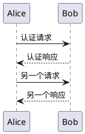

**箭头规则**：
| 语法 | 含义 |
|------|------|
| `->` | 实线，向右箭头 |
| `-->` | 虚线，向右箭头 |
| `<-` | 实线，向左箭头 |
| `<--` | 虚线，向左箭头 |

### 2.2 声明参与者

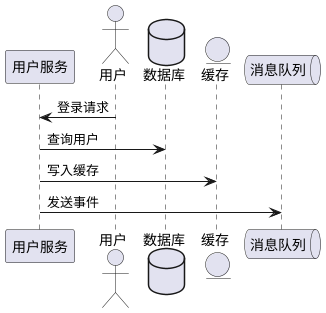

**支持的参与者类型**：`participant`、`actor`、`boundary`、`control`、`entity`、`database`、`collections`、`queue`

**注意**：
- 支持 `as` 别名：`actor "显示名称" as 别名`
- 支持 `order` 关键词控制显示顺序
- 参与者名含非字母字符时需要双引号
- 参与者形状自定义暂不支持（画板统一展示）

### 2.3 箭头样式

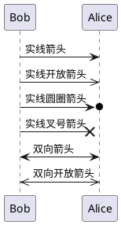

### 2.4 消息序列编号

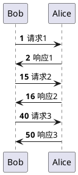

**语法**：
- `autonumber` — 从 1 开始，步长 1
- `autonumber N` — 从 N 开始，步长 1
- `autonumber N M` — 从 N 开始，步长 M

### 2.5 组合消息（片段）

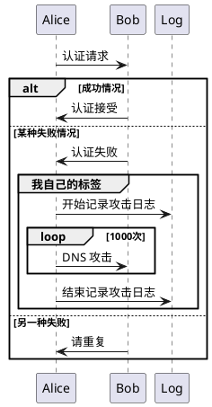

**支持的片段关键词**：`alt/else`、`opt`、`loop`、`par`、`break`、`critical`、`group`

**限制**：不支持次级分组标签（`group 标签 [次级标签]` 中次级标签会被降级忽略）

### 2.6 注释

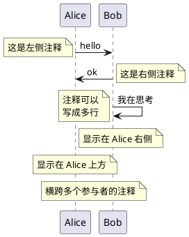

### 2.7 分割符与延迟

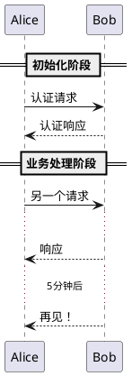

### 2.8 生命线激活与撤销

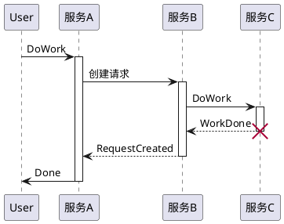

**快捷语法**：
- `++` 激活
- `--` 撤销
- `**` 创建
- `!!` 销毁

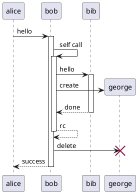

**自动激活**：

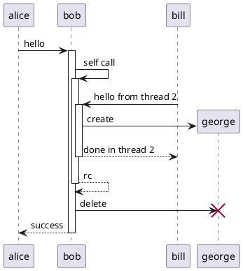

### 2.9 引用

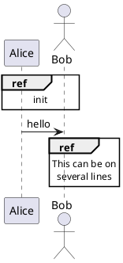

### 2.10 包裹参与者

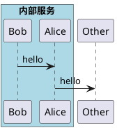

### 2.11 进入/发出消息

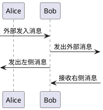

### 2.12 自身消息与换行

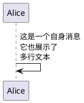

### 2.13 空间控制

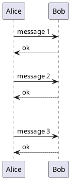

### 2.14 标题

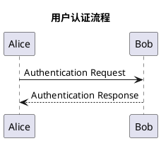

### ⚠️ 时序图不支持的语法

| 语法 | 状态 |
|------|------|
| 页眉/页脚 (header/footer) | ❌ 不支持 |
| `newpage` 分割 | ❌ 不支持 |
| Creole/HTML 格式 | ❌ 降级处理 |
| 构造类型 `<<>>` 显示 | ❌ 降级处理 |
| `teoz` 锚点/持续时间 | ❌ 降级处理 |
| 外观样式参数 (skinparam) | ❌ 不支持（可手动调节） |
| `?` 缩短箭头 | ❌ 不支持 |

---

