## 3. 流程图 / 活动图（Activity Diagram）

### 3.1 基础活动

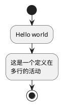

**格式**：`:活动描述;` — 冒号开始，分号结束。

### 3.2 条件判断

**if...then...else**：

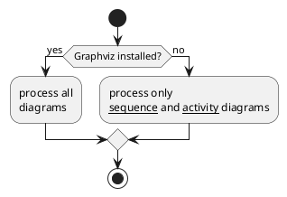

**if...is...then**：

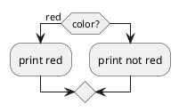

**if...equals...then**：

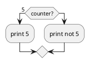

### 3.3 Switch 判断

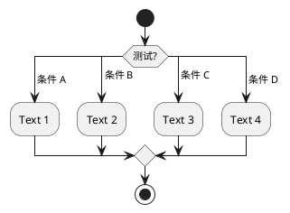

### 3.4 条件终止

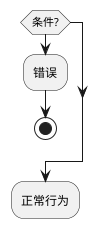

支持 `kill` 和 `detach` 关键词：

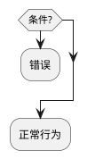

### 3.5 循环

**repeat...repeat while**：

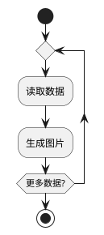

**repeat 带 backward**：

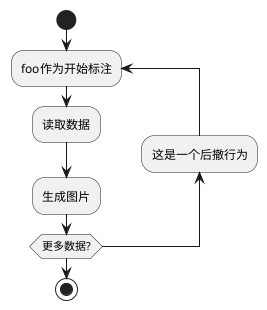

**while...endwhile**：

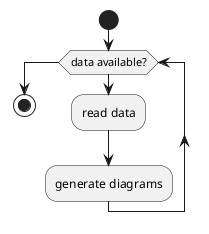

**while 带标注**：

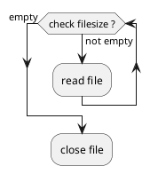

**break 打断循环**：

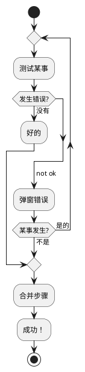

### 3.6 并行处理

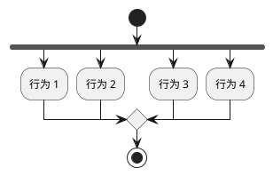

**end fork（带条件）**：

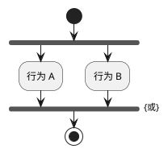

### 3.7 分割处理

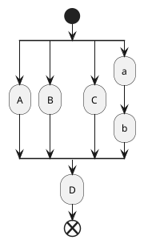

### 3.8 泳道（Swimlane）⭐

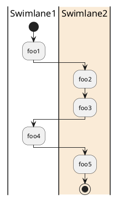

**泳道+条件判断**：

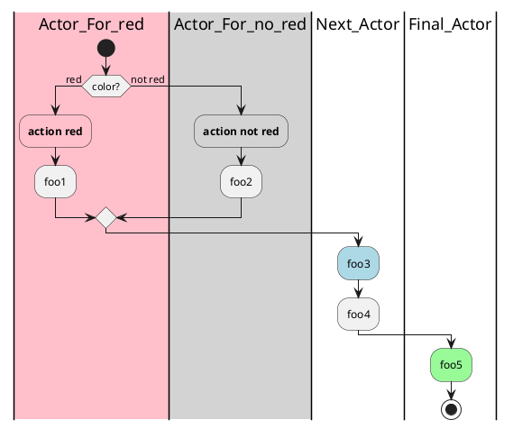

### 3.9 分组 (Group/Partition)

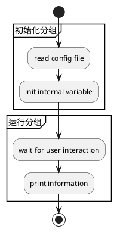

### 3.10 注释

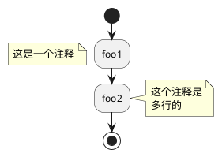

### 3.11 箭头样式

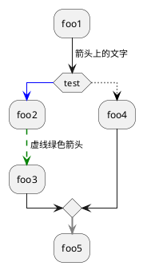

**支持的箭头样式**：`dotted`（点状）、`dashed`（虚线）、`bold`（加粗）

### 3.12 无箭头连接线

```plantuml
@startuml
skinparam ArrowHeadColor none
start
:Hello world;
:This is on defined on
several lines;
stop
@enduml
```

### 3.13 SDL 规范描述语言（部分支持）

```plantuml
@startuml
:Ready;
:next(o)|
:Receiving;
split
    :nak(i)<
    :ack(o)>
split again
    :ack(i)<
    :next(o)
    on several lines|
    :i := i + 1]
    :ack(o)>
split again
    :err(i)<
    :nak(o)>
split again
    :foo/
split again
    :bar\\
split again
    :i > 5}
stop
end split
:finish;
@enduml
```

**注意**：不支持的 SDL 符号会降级为圆角矩形。

### ⚠️ 流程图不支持的语法

| 语法 | 状态 |
|------|------|
| `!pragma useVerticalIf on` 垂直/水平模式 | ❌ 不支持 |
| Creole 文本样式 | ❌ 降级处理 |
| 外观样式参数 (skinparam) | ❌ 不支持（可手动调节） |

---

