## 4. 类图（Class Diagram）

### 4.1 元素声明

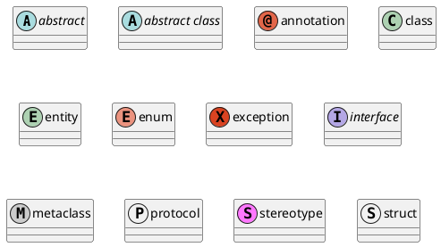

### 4.2 类关系

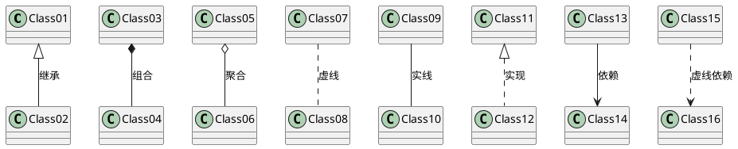

**关系符号速查**：

| 符号 | 含义 |
|------|------|
| `<\|--` | 继承（Extension） |
| `*--` | 组合（Composition） |
| `o--` | 聚合（Aggregation） |
| `-->` | 关联箭头 |
| `--` | 关联 |
| `..>` | 依赖（虚线箭头） |
| `<\|..` | 实现（虚线三角） |
| `..\|>` | 实现（虚线三角，反向写法） |
| `}--` | 映射 |
| `+--` | 嵌套 |
| `^--` | 定义 |

**注意**：用 `..` 代替 `--` 会显示虚线。

### 4.3 关系标签与基数

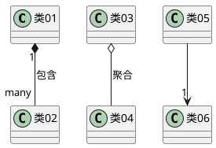

### 4.4 添加属性和方法

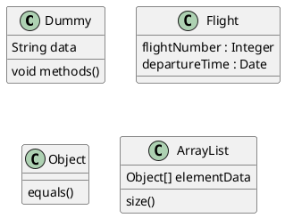

**强制字段/方法**：

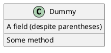

### 4.5 可见性修饰

| 符号 | 含义 |
|------|------|
| `-` | private |
| `+` | public |
| `#` | protected |
| `~` | package private |

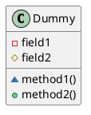

### 4.6 抽象与静态

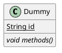

### 4.7 泛型

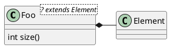

### 4.8 包（Package）

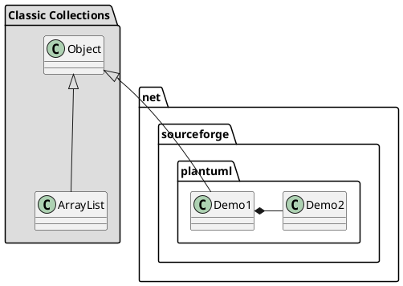

**包样式**：

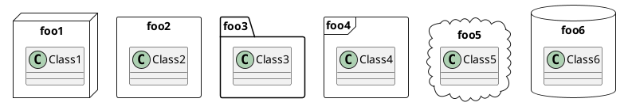

### 4.9 备注

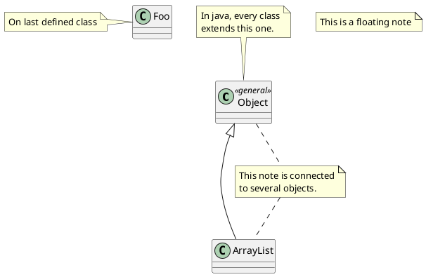

### 4.10 隐藏与显示控制

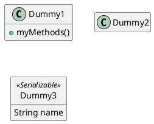

### 4.11 改变箭头方向

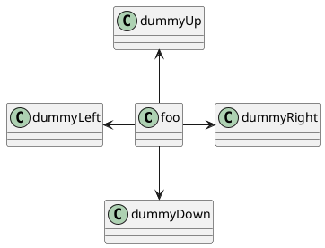

**规则**：
- 单破折号 `-` 水平方向
- 双破折号 `--` 垂直方向
- `left`, `right`, `up`, `down` 关键词强制方向

### 4.12 线样式

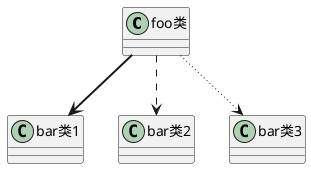

**支持的线样式**：`bold`、`dashed`、`dotted`、`hidden`、`plain`

### ⚠️ 类图不支持的语法

| 语法 | 状态 |
|------|------|
| 分隔符 `-- .. == __` | ❌ 降级处理 |
| 属性注释（注释到属性上） | ❌ 降级为类注释 |
| 棒棒糖接口 | ❌ 不支持 |
| 关系类 | ❌ 不支持 |
| 指定标记（Spot） | ❌ 不支持 |
| 线粗细调整 | ❌ 不支持 |
| 外观样式参数 | ❌ 不支持 |

---

