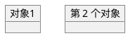
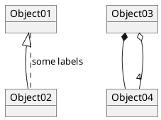
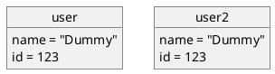
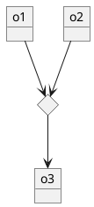
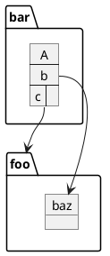
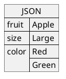

## 5. ER图 / 对象图（Object Diagram）

### 5.1 对象定义



### 5.2 对象关系



### 5.3 添加属性



### 5.4 关联对象（Diamond）



### 5.5 Map 表格

```plantuml
@startuml
object London

map CapitalCity {
    China *-> Beijing
    UK => London
    USA => Washington
    Germany => Berlin
}
@enduml
```

### 5.6 Package 嵌套



### 5.7 JSON 数据格式



---

