## 6. 状态图（State Diagram）

### 6.1 基础状态

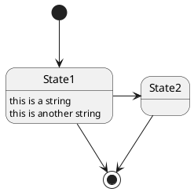

**关键**：`[*]` 表示起点和终点。

### 6.2 复杂（嵌套）状态

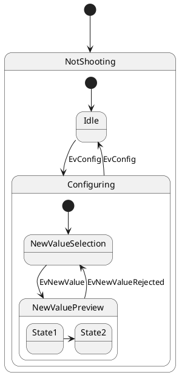

### 6.3 子状态间连接

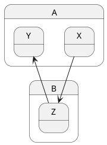

### 6.4 长状态名

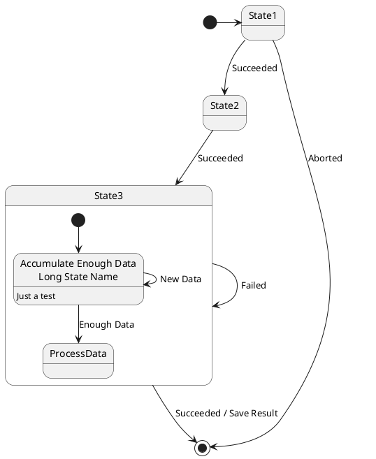

### 6.5 历史状态

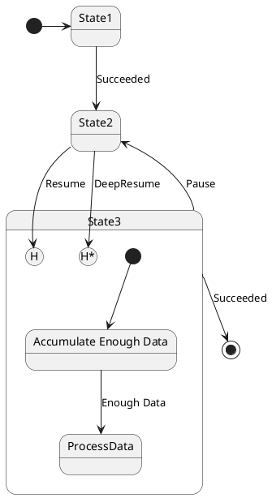

- `[H]` 浅层历史状态
- `[H*]` 深层历史状态

### 6.6 分支状态（Fork/Join）

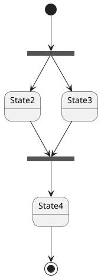

### 6.7 并发状态

**水平分割**（`--`）：

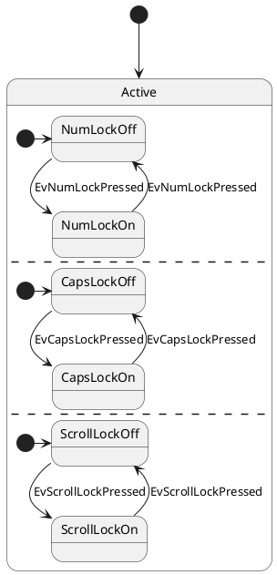

**竖直分割**（`||`）：

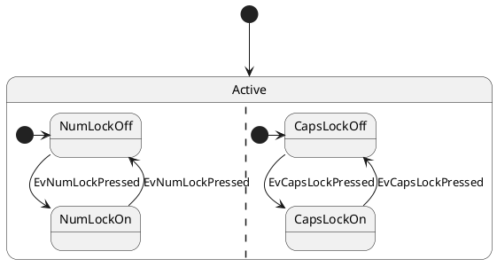

### 6.8 选择结点

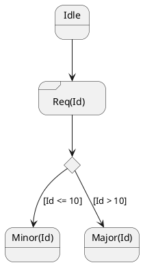

### 6.9 入口/出口结点

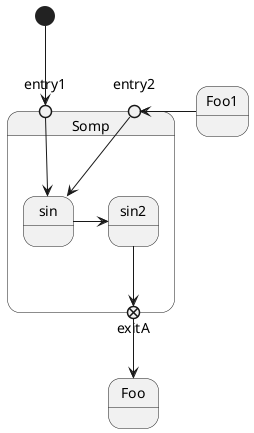

### 6.10 引脚结点

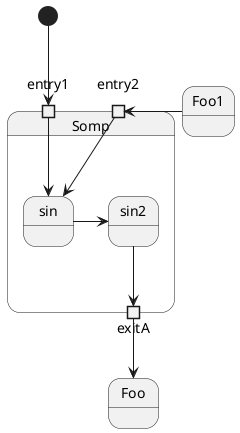

### 6.11 扩展结点

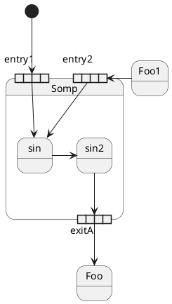

### 6.12 完整版型示例

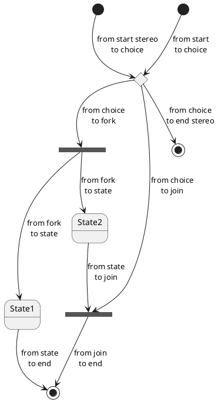

### 6.13 箭头方向

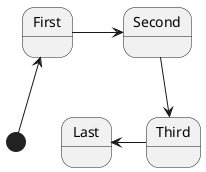

**注意**：不支持缩写形式（如 `-d-`、`-do-`），必须写完整 `-down->`。

### 6.14 注释

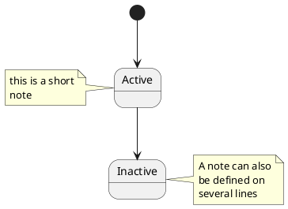

**浮动注释**：

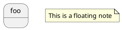

**嵌套状态注释**：

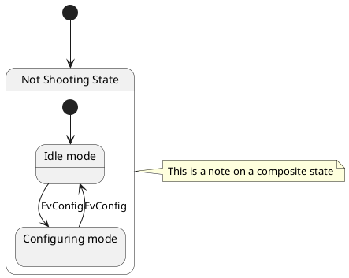

### ⚠️ 状态图不支持的语法

| 语法 | 状态 |
|------|------|
| `hide empty description` | ❌ 不支持 |
| `note on link` 箭头注释 | ❌ 降级为浮动注释 |
| 箭头颜色/风格 | ❌ 开发中 |
| 箭头方向缩写 (`-d-`) | ❌ 必须写完整 |
| 外观样式参数 | ❌ 不支持 |

---

