## 7. 用例图 / 组件图（UseCase / Component Diagram）

> **重要**：用例图和组件图的图形和语法可以混用。

### 7.1 用例

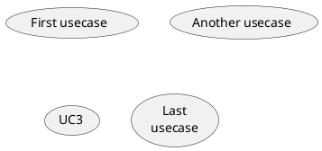

### 7.2 角色

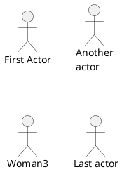

### 7.3 组件

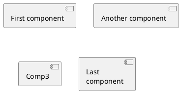

### 7.4 接口

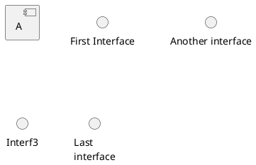

### 7.5 声明元素类型大全

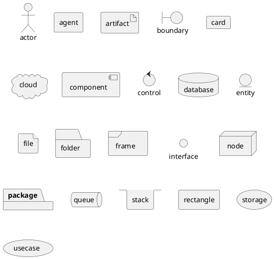

### 7.6 包和嵌套元素

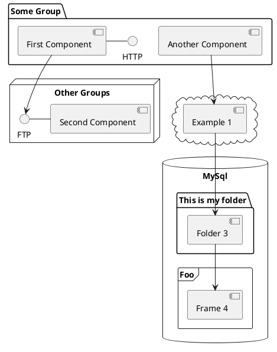

### 7.7 基础连接

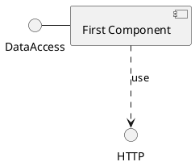

**连接规则**：
- `--` 实线
- `..` 虚线
- `-->` 箭头
- 横杠越多箭头越长

### 7.8 注释

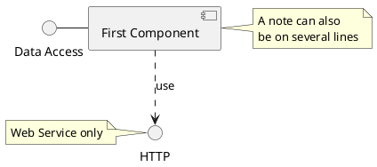

### 7.9 改变方向

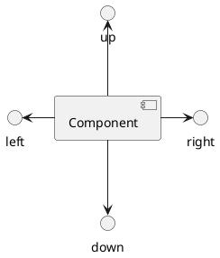

**从左向右构图**：

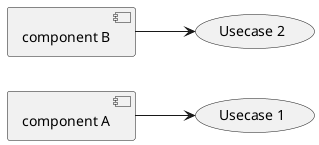

### 7.10 端口

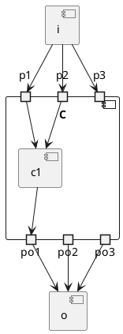

### 7.11 UML1 / 矩形标记符

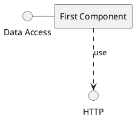

### 7.12 隐藏/删除控制

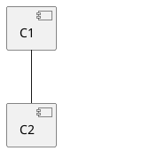

### 7.13 JSON 数据展示

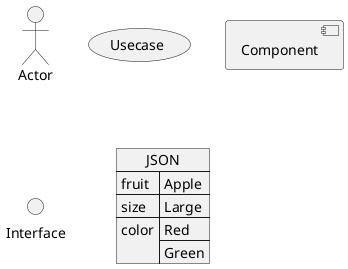

---

