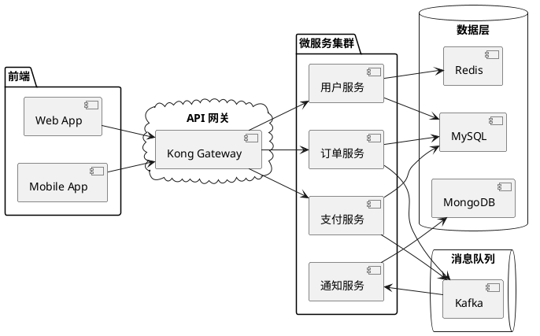
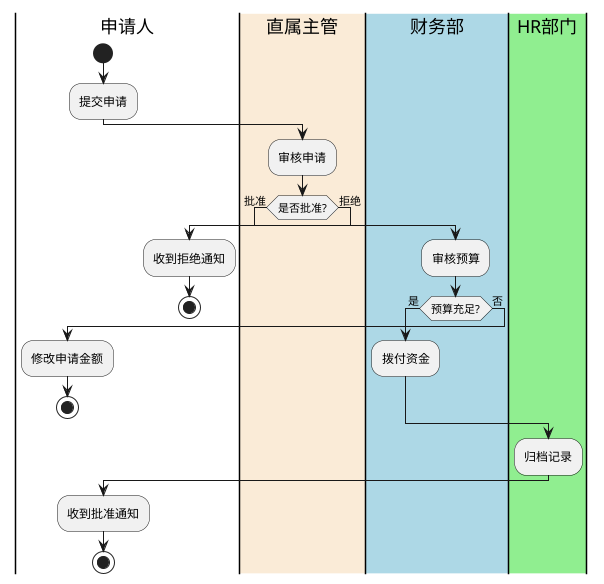
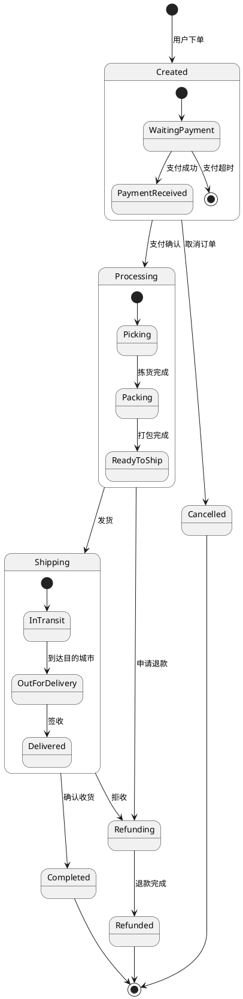
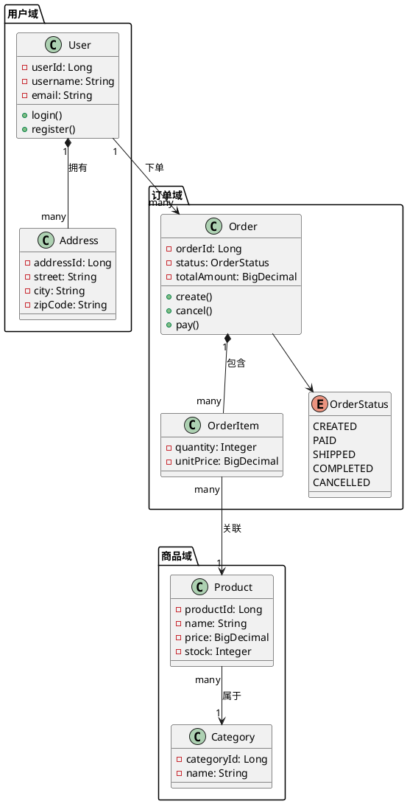

## 8. 通用语法与限制

### 8.1 画板通用支持

| 功能 | 语法 | 状态 |
|------|------|------|
| 标题 | `title 标题文本` | ✅ 支持 |
| 文本换行 | `\n` | ✅ 支持 |
| 别名 | `as 别名` | ✅ 支持 |
| 注释 | `note left/right/top/bottom of` | ✅ 支持 |
| 浮动注释 | `note "text" as N1` | ✅ 支持 |
| 方向控制 | `left to right direction` | ✅ 支持 |
| 填充色 | `#颜色` | ✅ 支持 |
| JSON 数据 | `json JSON { ... }` | ✅ 支持 |
| `allowmixing` | 混合图类型 | ✅ 支持 |
| `hide/show/remove` | 元素显隐 | ✅ 支持 |

### 8.2 画板全局不支持的语法

| 功能 | 状态 |
|------|------|
| Creole 文本格式 | ❌ 降级处理 |
| HTML 内嵌标签 | ❌ 降级处理 |
| `skinparam` 外观参数（大部分） | ❌ 不支持 |
| `skinparam ArrowHeadColor none` | ✅ 例外支持 |
| `skinparam componentStyle` | ✅ 例外支持 |
| 页眉/页脚 | ❌ 不支持 |
| `newpage` 分页 | ❌ 不支持 |
| 自定义颜色/字体等样式 | ❌ 不支持（可生成后手动调节） |

### 8.3 经典样式模式

画板支持选择渲染为 PlantUML 经典（官方）样式，此模式：
- 支持 `include C4 Model` 插件
- 输出为图片模式，**不支持生成后直接编辑图形**

---

## 9. 最佳实践与常见陷阱

### 9.1 最佳实践

1. **优先使用别名**：复杂名称使用 `as` 定义别名，后续引用更简洁
2. **合理使用方向控制**：`left to right direction` 适合宽度优先的图表
3. **泳道处理复杂流程**：跨角色协作的流程优先使用管道符 `|角色名|` 定义泳道
4. **分组提升可读性**：使用 `package`、`group`、`box` 对元素分组
5. **保持代码简洁**：画板不支持大部分样式参数，不需要写 skinparam
6. **充分利用注释**：`note` 语法为关键节点添加说明

### 9.2 常见陷阱

| 陷阱 | 解决方案 |
|------|---------|
| 写了大量 skinparam 样式 | 删除所有不支持的 skinparam，生成后手动调节 |
| 使用 Creole/HTML 格式化文本 | 使用纯文本 + `\n` 换行 |
| 状态图箭头方向缩写 `-d->` | 必须写完整 `-down->` |
| 类图分隔符 `-- .. == __` 期望有分隔线 | 会降级处理，不会显示分隔线 |
| 用 journey/quadrantChart/gitGraph | 这些是 Mermaid 专属，PlantUML 不支持 |
| 期望 `note on link` 显示在箭头上 | 状态图中会降级为浮动注释 |
| 参与者形状区分 | 画板统一样式，形状差异可能不明显 |

### 9.3 图表类型选择决策树

```
用户需求是什么？
├── 系统交互/API 调用/消息传递 → 时序图 (Sequence)
├── 业务流程/审批/决策 → 流程图/活动图 (Activity)
│   └── 涉及跨角色协作 → 活动图 + 泳道 (Swimlane)
├── 数据模型/类结构 → 类图 (Class)
├── 实体关系/对象结构 → ER图/对象图 (Object)
│   └── 展示 JSON 数据 → 对象图 + json 语法
├── 状态机/生命周期 → 状态图 (State)
│   └── 并发状态 → 状态图 + 并发分隔符 (--/||)
├── 需求分析/用户故事 → 用例图 (UseCase)
├── 系统架构/模块依赖 → 组件图 (Component)
│   └── 复杂架构 → 组件图 + 嵌套 package/node/cloud
└── 头脑风暴/知识结构 → 思维导图 (MindMap)
```

### 9.4 完整示例：微服务架构图



### 9.5 完整示例：审批流程（泳道）



### 9.6 完整示例：订单状态机



### 9.7 完整示例：类图（电商领域模型）



---

> **文档来源**：基于飞书画板 PlantUML 官方语法支持说明文档整理，涵盖时序图、流程图、类图、ER图、状态图、用例图、组件图全部已支持语法。
