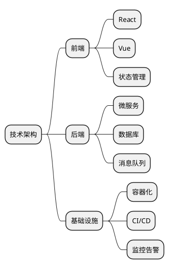
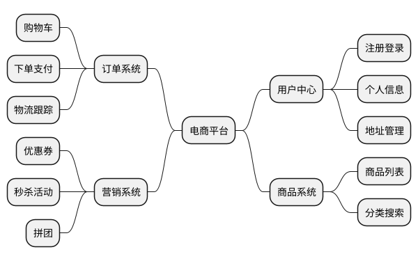
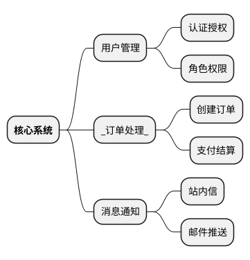
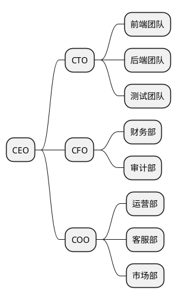

# 思维导图 Mindmap

> 适用于：头脑风暴、知识结构、分类体系、组织架构、模块拆解。
> **注意**：PlantUML 思维导图使用 `@startmindmap/@endmindmap`，不是 `@startuml`。

## 语法要点

```
@startmindmap
+ 根节点
++ 分支1
+++ 子分支1-1
+++ 子分支1-2
-- 左侧分支
--- 子分支
@endmindmap
```

- `+` 右侧分支（层级由 `+` 数量决定）
- `-` 左侧分支（层级由 `-` 数量决定）
- `@startmindmap/@endmindmap` 专用标记
- 可混用 `*` 标记（自动选择方向）

## 方向控制

| 语法 | 含义 |
|------|------|
| `+` | 向右展开 |
| `-` | 向左展开 |
| `*` | 自动选择方向 |

## 示例 1：技术架构（右侧展开）



## 示例 2：双向展开



## 示例 3：带样式节点



**文本样式**：
- `**粗体**` — 加粗
- `_斜体_` — 斜体
- `""等宽""` — 等宽字体

## 示例 4：组织架构



## 常见错误

| 错误 | 正确 |
|------|------|
| `@startuml` 开头 | `@startmindmap` 专用标记 |
| `+` 数量不对应层级 | 每多一级多一个 `+` |
| 混用 `+` 和 `*` 导致方向混乱 | 统一用 `+`/`-` 控制方向 |
| 节点文本含特殊字符 | 用纯文本，避免 `{}[]<>` |
| 忘记 `@endmindmap` | 必须闭合 |
